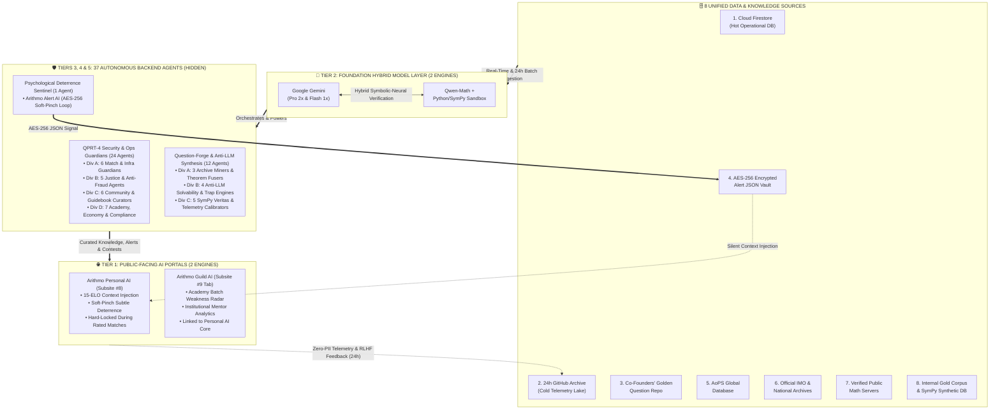
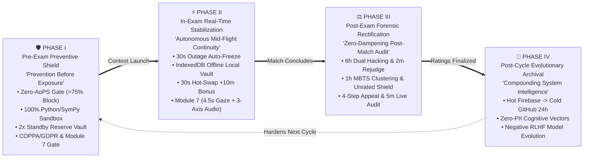
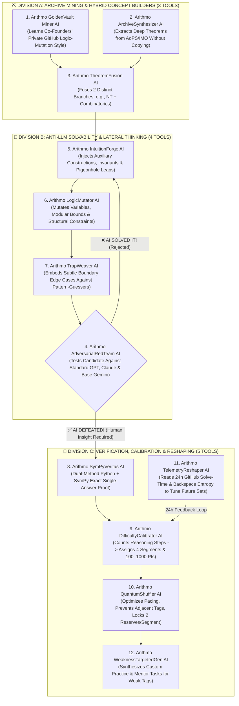
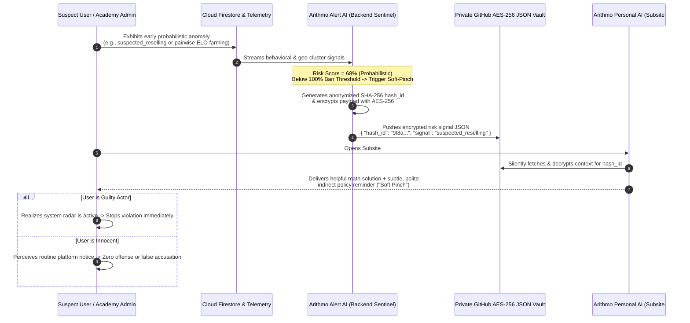

<div align="center">


# 🧠 Arithmo-Edge Autonomous AI & `QPRT-4` Neural Architecture

*41 Specialized AI Engines • The Arithmo-Edge Quad-Phase Resilience Theory (`QPRT-4`) • Anti-LLM Synthesis • 8 Unified Data Sources*

<p>
  
  
  
  
  
  
</p>

</div>

---

## 🌐 Executive Overview & 41-Engine Mathematical Inventory

The **Arithmo-Edge** ecosystem (*Powered by Olympiad Edge*) is governed by a proprietary, multi-tiered neural infrastructure comprising **41 distinct, specialized AI engines and autonomous guardians**. Unlike monolithic chatbot wrappers, Arithmo-Edge decouples **user-facing pedagogical mentorship** (`2 Engines`) from **foundation hybrid reasoning** (`2 Engines`) and **37 invisible, autonomous backend agents** (`24 QPRT-4 Guardians + 12 Question-Forge Engines + 1 Psychological Deterrence Sentinel`).

### 🔢 Exact Architectural Breakdown (`2 + 2 + 24 + 12 + 1 = 41 Engines`)

| Tier | Architectural Layer | Engine Count | Visibility | Core Mandate |
| :--- | :--- | :---: | :--- | :--- |
| **Tier 1** | **Public-Facing Core AI Systems** | **2** | User / Admin Portals | Personalized Olympiad mentorship (`Subsite #8`) & institutional batch diagnostics (`Subsite #9`). |
| **Tier 2** | **Foundation Hybrid Model Layer** | **2** | Internal Inference Bus | Dual-mode cognitive routing (`Gemini Pro/Flash` + `Qwen-Math`) backed by deterministic `Python + SymPy`. |
| **Tier 3** | **`QPRT-4` Backend Security & Operations Guardians** | **24** | Strictly Hidden (Backend) | 24/7 autonomous protection across pre-exam, live match, post-exam forensics, curation, and economy. |
| **Tier 4** | **Autonomous Question-Forge & Anti-LLM Synthesis** | **12** | Strictly Hidden (Backend) | Original Olympiad problem synthesis engineered to defeat commercial LLMs while rewarding human insight. |
| **Tier 5** | **Psychological Deterrence & Risk Detection** | **1** | Strictly Hidden (Backend) | Probabilistic anomaly detection writing `AES-256` encrypted signals for non-accusatory soft-pinch warnings. |
| **TOTAL** | **Unified Arithmo-Edge Neural Ecosystem** | **41** | **Multi-Tiered** | **Zero-leak, zero-downtime, self-evolving competitive mathematics ecosystem.** |

---

### 🗺️ High-Level Neural Topology & Data Flow



---

### 🧩 Detailed Tier 1 & Tier 2 Architecture

#### 1. Public-Facing Core AI Systems (`2 Engines`)
* **1. `Arithmo Personal AI` (`Subsite #8`):**
  * **Context-Injected Olympiad Mentor:** Dynamically ingests the student's **15 distinct ELO ratings** (across Number Theory, Algebra, Combinatorics, Geometry, Blitz, Rapid, Classical, etc.), recent `24h` solve-time telemetry, and weak tag clusters to tailor Socratic hints rather than spoiling full solutions.
  * **Live-Match Hard Lock:** Automatically enters a cryptographic `HARD-LOCKED` state the millisecond a user enters any live rated contest or `1v1` match, preventing real-time external assistance.
  * **AES-256 Soft-Pinch Receiver:** Silently reads decrypted risk flags from the private GitHub Alert Vault to weave non-accusatory policy reminders into natural mathematical conversations.
* **2. `Arithmo Guild AI` (`Subsite #9 Navbar Tab`):**
  * **Institutional Diagnostic & Batch Intelligence Engine:** Exclusively accessible to verified Academy Admins (`Academy Premium`, `Supreme`, and `Enterprise` tiers) via the dedicated navbar tab inside `Subsite #9`.
  * **Cross-Roster Synthesis:** Directly linked to `Arithmo Personal AI` and `Arithmo BatchRadar AI` to aggregate cohort-wide failure patterns, automate custom `Task` homework generation, and benchmark institutional progress against global Olympiad percentiles.

#### 2. Foundation Hybrid Model Layer (`2 Engines`)
* **3. `Google Gemini (Pro & Flash)` Engine:**
  * **Dual-Mode Semantic Routing:** Governed by `Arithmo TokenMeter AI`, routine queries and rapid clarifications route through **`Gemini Flash` (`General 1x` mode)** for sub-second latency, whereas deep multi-lemma proof synthesis, diagram reasoning, and holistic telemetry audits invoke **`Gemini Pro` (`Premium 2x` mode)**.
* **4. `Qwen-Math` Symbolic-Neural Hybrid Engine:**
  * **Deterministic Verification Pairing:** Specialized for high-precision algebraic manipulation, modular arithmetic, and symbolic inequality bounding. Every mathematical output generated by `Gemini` or `Qwen-Math` is cross-checked inside a deterministic **`Python + SymPy` execution sandbox** before reaching any student or contest vault, eliminating LLM arithmetic hallucinations.

---

## 🔬 Deep-Dive Architectural Specifications

<details open>
<summary><b>🛡️ DROPDOWN 1: The Arithmo-Edge Quad-Phase Resilience Theory (<code>QPRT-4</code>)</b></summary>

<br />

**The Arithmo-Edge Quad-Phase Resilience Theory (`QPRT-4`)** (*চতুর্ভুজ প্রতিরোধ ও অখণ্ডতা তত্ত্ব*) is Arithmo-Edge's foundational operational doctrine. It enforces **four chronological, overlapping defense perimeters** around every rated contest, `1v1` duel, and institutional assessment—ensuring that neither problem leaks, server outages, heuristic ambiguities, nor false cheating flags can compromise competitive integrity.



### 🔹 Phase I: Pre-Exam Preventive Shield (*"Prevention Before Exposure"*)
* **Core Philosophy:** Eliminate structural flaws, plagiarism, and hardware/compliance discrepancies before a single competitor views Problem 1.
* **Active Mechanisms:**
  * **Zero-AoPS Similarity Gate:** `Arithmo PlagioGuard AI` runs semantic AST (Abstract Syntax Tree) and LaTeX embedding comparisons against the Art of Problem Solving (`AoPS`) Wiki, `IMO`, and national Olympiad archives. Any candidate problem exhibiting **`>75%` structural or semantic similarity** is automatically blocked and returned to problem setters.
  * **100% `Python + SymPy` Verification Sandbox:** Every problem—especially high-stakes Apex segment problems—must pass automated symbolic execution inside a sandboxed `Python + SymPy` environment, proving a unique, exact answer with zero boundary ambiguity.
  * **Standby Reserve Vault:** For every active contest segment, `2` fully verified, difficulty-calibrated backup problems (e.g., `Reserve A1`, `Reserve A2`) are locked in an encrypted standby vault ready for instant hot-swapping.
  * **COPPA/GDPR & Hardware Permission Gate:** Prior to match entry, the system verifies age-compliant consent tokens, ELO bracket eligibility, and active browser permissions for **`Module 7`** (webcam gaze tracking and microphone acoustic sampling).

### 🔹 Phase II: In-Exam Real-Time Stabilization (*"Autonomous Mid-Flight Continuity"*)
* **Core Philosophy:** Absorb infrastructure shocks, network drops, or live problem leaks mid-flight without halting the match or penalizing honest competitors.
* **Active Mechanisms:**
  * **Auto-Freeze & Time-Extension Watchdog:** `Arithmo GridShield AI` and `Arithmo NightWarden AI` monitor database read/write latency every `10 seconds`. If a cloud outage or DDoS spike exceeds **`30 seconds`**, the global contest clock transitions to **`FROZEN`**, and exact lost minutes are appended automatically upon recovery.
  * **Offline Local Vault + Auto-Sync:** Client browsers maintain an AES-encrypted **`IndexedDB` Offline Local Vault**. If a student's local ISP drops, every answer and keystroke is sealed locally with a millisecond cryptographic timestamp and auto-synced upon reconnection.
  * **30-Second Standby Hot-Swap & Question Quarantine:** If `Arithmo PulseWatcher AI` detects an anomalous solve-velocity spike (indicating an external AoPS leak) or a hidden heuristic flaw, the compromised problem is immediately marked **`QUARANTINED`**, swapped with reserve problem **`A2` within `30 seconds`**, and all participants receive a **`+10 minute` global bonus extension**.
  * **Module 7 (`4.5s` Adaptive Gaze Guard & `3-Axis` Audio Trap):** Browser-native computer vision respects legitimate cognitive thinking pauses (looking away for up to `4.5s` during deep mental calculation) while tri-axial acoustic fingerprinting detects whispered coaching, secondary device notifications, or multi-speaker collusion.

### 🔹 Phase III: Post-Exam Forensic Rectification (*"Zero-Dampening Post-Match Audit"*)
* **Core Philosophy:** Purge every trace of judge error, edge-case oversight, or unfair ELO loss before official ratings are committed.
* **Active Mechanisms:**
  * **6-Hour Dual Hacking & Instant Global Rejudge:** Following contest end, a `6-hour` Dual Hacking window allows competitors to submit counterexamples exposing edge-case or judge-key flaws. If validated by `Arithmo AxiomCheck AI`, a **global rejudge completes within `2 minutes`**, restoring wasted submission slots and erasing wrongful time penalties.
  * **MBTS Telemetry Clustering & Asymmetric ELO Shield:** During the `1-hour` post-match audit window, `Arithmo ChronoVault AI` runs Multi-Behavioral Telemetry Synthesis (`MBTS`) clustering to separate authentic human solvers from cheaters. If a round suffered a severe leak or systemic disruption, the **Asymmetric ELO Shield** marks the round **`Unrated for Negative Delta`**—honest players never lose ELO, while verified top performers retain earned gains.
  * **4-Step Forensic Appeal & 5-Min Live Skill Audit:** Flagged competitors may initiate a structured 4-step appeal comprising: (1) full telemetry replay inspection, (2) `Arithmo HonestyScore AI` probability scoring, (3) a **`5-minute` proctored live skill audit** solving an isomorphic problem on camera, and (4) final Chief Arbiter adjudication.

### 🔹 Phase IV: Post-Cycle Evolutionary Archival (*"Compounding System Intelligence"*)
* **Core Philosophy:** Transform every completed competition into permanent, privacy-safe training fuel that hardens future cycles.
* **Active Mechanisms:**
  * **Hot Firebase + Cold GitHub `24h` Data Lake:** Every `24 hours`, `Arithmo ChronoVault AI` and `Arithmo ComplianceGuard AI` extract completed match logs from Cloud Firestore, strip 100% of Personally Identifiable Information (`Zero-PII`), and push compressed `JSONL` cognitive vectors, backspace entropy curves, and hacking counterexamples to a private GitHub Data Lake.
  * **Continuous Hybrid Model Evolution:** Newly harvested `verified_gold_data` and negative RLHF counterexamples are continuously indexed into the retrieval pipelines of `Arithmo Personal AI` and `Arithmo Guild AI`, compounding platform intelligence with every match.

</details>

---

<details open>
<summary><b>🤖 DROPDOWN 2: All 24 <code>QPRT-4</code> Backend Security, Justice & Operations AI Guardians</b></summary>

<br />

These **24 autonomous backend agents** operate strictly behind the scenes across Arithmo-Edge's 13 websites, question banks, live contest servers, and headquarters war-room. **Zero end-users can directly prompt or access these agents.**

#### ⚔️ Division A — Match Verification & Live Contest Guardians (`6 Core Agents`)

| # | Engine Name | `QPRT-4` Phase | Operational Mandate & Autonomous Trigger |
| :---: | :--- | :---: | :--- |
| **1** | **`Arithmo PlagioGuard AI`** | Phase I | Scans candidate problems against **AoPS Wiki**, **IMO**, and national Olympiad archives prior to contest publication. Computes semantic and mathematical equivalence; **blocks any problem exceeding `75%` similarity** and instructs problem setters to mutate structural conditions. |
| **2** | **`Arithmo AxiomCheck AI`** | Phase I & III | Integrates directly with the **`Python + SymPy` sandbox** to verify single-answer determinism, boundary conditions, and heuristic safety before launch. During the `6-hour` hacking phase, validates submitted counterexamples and executes a **full global rejudge within `2 minutes`**. |
| **3** | **`Arithmo PulseWatcher AI`** | Phase II | Monitors live contest telemetry in real time—tracking solve-velocity anomalies (indicative of external leaks) and high-rated user bug reports. Upon detecting compromise, locks the problem as **`QUARANTINED`** and executes a **`30-second` standby reserve swap**. |
| **4** | **`Arithmo NightWarden AI`** | Phase II | Assumes autonomous command-center authority during Bangladesh midnight hours or whenever human HQ staff are offline. Issues emergency global announcements, triggers **`Safe-Rollback` / `Unrated`** protections during critical incidents, and dispatches **automatic compensation tokens** to affected user wallets. |
| **5** | **`Arithmo GridShield AI`** | Phase II | Pings **Firebase**, **Cloudflare Workers**, and **GitHub Pages** endpoints every **`10 seconds`** to measure read/write pressure and latency. During DDoS spikes or cloud lag, automatically sets the contest clock to **`FROZEN`**, activates the browser **`IndexedDB` Offline Vault**, and appends exact recovery minutes post-stabilization. |
| **6** | **`Arithmo ChronoVault AI`** | Phase III & IV | Executes post-match **`MBTS` telemetry clustering** to isolate cheaters from legitimate solvers and computes baseline appeal `Honesty Scores`. Every **`24 hours`**, exports `Zero-PII` mathematical vectors as encrypted `JSONL` files to the private GitHub Data Lake. |

#### ⚖️ Division B — Appeal, Justice & Anti-Fraud Command Agents (`5 Agents`)

| # | Engine Name | Domain | Operational Mandate & Autonomous Trigger |
| :---: | :--- | :---: | :--- |
| **7** | **`Arithmo AppealTriage AI`** | Forensic Appeals | Scans hundreds of incoming submissions on the Forensic Appeal Portal, auto-dismisses bad-faith spam appeals, and elevates high-probability false-positive cases to the top of the Chief Arbiter queue. |
| **8** | **`Arithmo HonestyScore AI`** | Telemetry Forensics | Synthesizes **`Module 7` gaze vectors**, keystroke cadence entropy, and **`5-minute` Live Skill Audit** performance to calculate an objective **`0%–100%` Honesty Probability Score** for Chief Arbiters. |
| **9** | **`Arithmo CollusionHunter AI`** | Rating Integrity | Detects pairwise `1v1` ELO boosting rings (intentional forfeits/throws between paired accounts) and silently neutralizes **4-signal alt-account / self-upvote manipulation networks** without tipping off bad actors. |
| **10** | **`Arithmo ResellerShield AI`** | Institutional Fraud | Identifies fraudulent educators or resellers creating fake shell academies to resell discounted seats by auditing **member geographic dispersion** and **zero-`Task` institutional inactivity**. |
| **11** | **`Arithmo BanAudit AI`** | Due Process Guard | Enforces a mandatory pre-punishment audit before any temporary suspension or permanent **`11-Flag` Ladder ban** executes—re-verifying the user's **last `6` clean matches** and raw telemetry to guarantee zero innocent students are wrongfully banned. |

#### 📚 Division C — Guidebook, Suggestion & Community Curation Agents (`6 Agents`)

| # | Engine Name | Domain | Operational Mandate & Autonomous Trigger |
| :---: | :--- | :---: | :--- |
| **12** | **`Arithmo GuideCurator AI`** | Knowledge Base | Deduplicates community-submitted theorems for the **Free Guidebook** and **Academy Guidebook**, normalizes `LaTeX` syntax, and queues verified entries for **`+2 Contribution ELO`** approval at HQ. |
| **13** | **`Arithmo SuggestionMiner AI`** | Product Ops | Ingests thousands of user feedback tickets and bug reports, deduplicates similar requests, and clusters them into prioritized **`UI`**, **`Contest`**, **`Bug`**, and **`Feature`** queues inside **`Subsite #12: Headquarters Core`**. |
| **14** | **`Arithmo BlogScout AI`** | Talent Discovery | Evaluates mathematical rigor and originality across **`Arithmo Socials`** blog posts, nominating standout theoretical essays for **Blog-to-Lab (`+5 Contribution ELO`)** induction. |
| **15** | **`Arithmo ForumModerator AI`** | Trust & Safety | Real-time semantic moderation across discussion boards, `Q&A` threads, and **`@handle` Direct Messages**—blocking toxicity, phishing links, and live contest answer spoilers instantaneously. |
| **16** | **`Arithmo ProofGrader AI`** | Automated Grading | Evaluates step-by-step deductive logic in **`2000+ Expert Q&A`** submissions and Mentor-assigned **`Task` homework**, flagging logical leaps or missing base cases. |
| **17** | **`Arithmo TagArchitect AI`** | Taxonomy Engine | Automatically classifies every new problem across the **4 Core IMO Hubs** (*Number Theory, Algebra, Combinatorics, Geometry*) with granular Olympiad technique tags (e.g., `#Pigeonhole`, `#Vieta-Jumping`, `#Radical-Axis`). |

#### 🏛️ Division D — Academy, Economy & Compliance Operations Agents (`7 Agents`)

| # | Engine Name | Domain | Operational Mandate & Autonomous Trigger |
| :---: | :--- | :---: | :--- |
| **18** | **`Arithmo AcademyKYB AI`** | Institutional KYB | Verifies official school/coaching letterheads, institutional email domains, and registration licenses during **`Academy Premium`**, **`Supreme`**, and **`Enterprise`** onboarding. |
| **19** | **`Arithmo BatchRadar AI`** | Cohort Analytics | Analyzes multi-hundred-student academy performance matrices to alert Mentors and Admins to specific mathematical sub-topics where an entire batch is underperforming. |
| **20** | **`Arithmo TokenMeter AI`** | Quota & Routing | Enforces dynamic semantic metering across `Arithmo Personal AI` and `Arithmo Guild AI`—charging **`-1` token** for duplicate queries, **`-N` tokens** for bundled multi-queries, and **`0` tokens** for greetings—while controlling the in-chat **`General (1x)` vs `Premium (2x)`** selector pop-up and dynamic default routing. |
| **21** | **`Arithmo WalletLedger AI`** | Financial Audit | Continuously audits every transaction, **`+10%` top-up bonus**, scholarship credit, and chargeback lock across both **Personal Arithmo Wallets** and **Institutional Academy Wallets**. |
| **22** | **`Arithmo ShadowBot AI`** | Matchmaking Liquidity | Spawns ELO-calibrated, human-paced sparring bots if a student in an unrated `1v1` Blitz practice pool is not matched with a human opponent within **`10 seconds`**, eliminating cold-start wait times. |
| **23** | **`Arithmo HQStrategist AI`** | Executive Strategy | Embedded exclusively inside **`Subsite #12: Headquarters Core`** war-room chat to advise the Founder and **Prime Sovereign** panel on platform growth trajectories, mega-contest themes, and data lake health. |
| **24** | **`Arithmo ComplianceGuard AI`** | Privacy & Legal | Enforces strict **COPPA / GDPR-K** minor-protection rules and executes a final pre-push PII scrub right before the `24-hour` GitHub Data Lake sync, ensuring zero names, emails, avatars, or IPs enter training datasets. |

</details>

---

<details open>
<summary><b>⚒️ DROPDOWN 3: All 12 Autonomous Question-Forge & Anti-LLM Synthesis Tools</b></summary>

<br />

Modern commercial LLMs (`GPT`, `Claude`, standard `Gemini`) can trivially solve routine textbook problems via pattern memorization. Arithmo-Edge neutralizes AI-assisted cheating at the **source** through a **12-engine Autonomous Question-Forge & Anti-LLM Synthesis Pipeline** that rejects any problem solvable by standard foundation models.



#### ⛏️ Division A — Archive Mining & Hybrid Concept Builders (`3 Tools`)
1. **`Arithmo GoldenVault Miner AI`:** Directly analyzes the **Co-Founders' Private Golden GitHub Repository** (containing thousands of original and logic-mutated Olympiad problems) to internalize their signature creative transformation patterns and aesthetic rigor.
2. **`Arithmo ArchiveSynthesizer AI`:** Mines deep mathematical theorems, lemmas, and proof techniques from the **AoPS Database** and official **IMO / National Olympiad archives** without copying problem statements or surface structures.
3. **`Arithmo TheoremFusion AI`:** Synthesizes multi-concept hybrid problems by fusing theorems across two distinct Olympiad hubs (e.g., combining *Number Theory* lifting-the-exponent lemmas with *Combinatorial* extremal graph bounds) so single-formula lookup fails.

#### 🧬 Division B — Anti-LLM Solvability & Lateral Thinking Engines (`4 Tools`)
4. **`Arithmo AdversarialRedTeam AI` (*Direct AI-Solve Prevention*):** The cornerstone gatekeeper of the forge. Before any synthesized problem is approved, this engine feeds it into an adversarial gauntlet of standard commercial LLMs (**GPT**, **Claude**, and **base Gemini**). **If any standard AI solves the problem directly, it is immediately rejected and looped back for deeper structural mutation** until only genuine human mathematical creativity can crack it.
5. **`Arithmo IntuitionForge AI`:** Deliberately injects lateral-thinking hurdles—such as non-obvious **auxiliary geometric constructions**, **algebraic invariants/monovariants**, and **Pigeonhole leaps**—where autoregressive token-predicting LLMs systematically stall.
6. **`Arithmo LogicMutator AI`:** Transforms classical problem variables, modular bounds, domain restrictions, and symmetry conditions so memorized competition shortcuts yield wrong answers.
7. **`Arithmo TrapWeaver AI`:** Embeds subtle boundary edge cases (e.g., $n=1, 2$ degenerate cases or non-coprime exceptions) specifically engineered to catch superficial competitors who guess patterns from small cases without rigorous proof.

#### 📐 Division C — Verification, Calibration & Telemetry Reshaping (`5 Tools`)
8. **`Arithmo SymPyVeritas AI`:** Executes dual-method verification inside a backend **`Python + SymPy` symbolic sandbox**, mathematically guaranteeing that every problem possesses **exactly one deterministic, exact answer** with zero heuristic ambiguity.
9. **`Arithmo DifficultyCalibrator AI`:** Quantifies the exact number of deductive reasoning steps and expected human solve latency to slot each problem into the **4 contest segments** and assign calibrated **`100` to `1000` point weights**.
10. **`Arithmo QuantumShuffler AI`:** Orders contest problem sets for optimal psychological pacing (anchoring accessible opening problems to build momentum), prevents consecutive duplicate topic tags, and locks **`2` verified standby reserve problems per segment** into the Phase I vault.
11. **`Arithmo TelemetryReshaper AI`:** Ingests empirical solve-time latency, abandonment rates, and backspace entropy from the **`24-hour` GitHub Data Lake** to continuously recalibrate future problem parameters and point curves.
12. **`Arithmo WeaknessTargetedGen AI`:** Synthesizes bespoke practice drills and Mentor-assigned **`Task` homework** dynamically tailored to an individual student's or an entire academy batch's lowest-performing Olympiad tags.

</details>

---

<details open>
<summary><b>🕵️ DROPDOWN 4: <code>Arithmo Alert AI</code> & The Encrypted Soft-Pinch Deterrence Loop</b></summary>

<br />

Issuing permanent bans on probabilistic suspicion risks humiliating innocent students and creating legal defamation exposure; conversely, waiting weeks for hard proof allows resellers and ELO boosters to damage platform integrity. **`Arithmo Alert AI`** solves this dilemma via a **non-accusatory, zero-false-accusation Psychological Deterrence Loop (*Soft-Pinch Protocol*)**.



### 🔄 Four-Stage Execution Pipeline
1. **Stage 1 — Approximate Risk Detection (`Probabilistic Triage`):**
   * When `Arithmo Alert AI` detects early behavioral anomalies—such as abnormal IP/geographic dispersion across an academy roster (`suspected_reselling`) or repetitive low-effort forfeits between paired accounts (`suspected_collusion`)—before `100%` forensic proof exists, it refrains from issuing a punitive ban.
2. **Stage 2 — `AES-256` Encrypted GitHub Signal Sync:**
   * `Arithmo Alert AI` hashes the user's identifier into an anonymized `hash_id`, packages the risk classification (`suspected_reselling`, `suspected_collusion`, or `telemetry_anomaly`), and writes an **`AES-256` encrypted JSON payload** into a restricted private GitHub vault monitored by `Arithmo Personal AI`.
3. **Stage 3 — Subtle Pinch & Indirect Warning (`Arithmo Personal AI` on `Subsite #8`):**
   * The next time the flagged user interacts with `Arithmo Personal AI`, the model **never accuses them directly**. Instead, alongside answering their mathematical question, it seamlessly weaves a polite, contextual policy reminder (*Soft Pinch*) into the conversation:
     * *For suspected institutional reselling:* *"By the way, as a friendly reminder, Arithmo-Edge's security engine continuously audits geographic dispersion and active Mentor Task engagement—ensuring only authentic, verified academies remain active long-term."*
     * *For suspected ELO boosting / collusion:* *"Keep in mind that our pairwise match telemetry and behavioral clustering silently log every rating anomaly—consistent, independent practice is always the safest path to mastery."*
4. **Stage 4 — Asymmetric Psychological Outcome (`Zero False-Accusation + High Deterrence`):**
   * **If guilty:** The user immediately realizes they are inside the platform's active radar and ceases the violation before irreversible damage occurs.
   * **If innocent:** Because no accusation was ever made, the user experiences zero embarrassment, zero friction, and zero legal dispute risk.

</details>

---

<details open>
<summary><b>🗄️ DROPDOWN 5: All 8 Unified Data & Knowledge Sources (Hot Firebase + Cold GitHub Data Lake)</b></summary>

<br />

<div align="center">
  
</div>

<br />

All **41 AI engines** draw synchronized intelligence from **8 distinct, strictly governed data and knowledge sources** spanning real-time operational cloud storage, automated `24-hour` cold GitHub data lakes, private golden repositories, and verified global Olympiad archives:

| # | Data Source Name | Storage Layer & Cadence | Primary Consumers | Contents & Architectural Role |
| :---: | :--- | :--- | :--- | :--- |
| **1** | **Real-Time Cloud Firestore** (*Hot Operational DB*) | Google Cloud Firestore (`Millisecond Sync`) | `Personal AI`, `Guild AI`, `PulseWatcher`, `GridShield`, `WalletLedger` | Stores live **15-category ELO ratings**, Personal/Academy wallet balances, active subscription tiers, live contest states, and recent match logs. |
| **2** | **24-Hour Automated GitHub Archive Repo** (*Cold Telemetry Lake*) | Private GitHub Repository (`24h Cron Push`) | `ChronoVault`, `TelemetryReshaper`, `HonestyScore`, `Personal AI` | Automated daily export of historical matches, solve-time latency curves, backspace entropy, and **`Zero-PII` `JSONL` cognitive vectors**. |
| **3** | **Co-Founders' Private Golden Question Repository** | Private GitHub Repository (`Version-Controlled`) | `GoldenVault Miner AI`, `TheoremFusion AI` | Houses thousands of original and logic-mutated Olympiad problem sets hand-crafted by the Founder & Co-Founder as the gold-standard creative template. |
| **4** | **AES-256 Encrypted Security & Alert JSON Vault** | Private GitHub Vault (`Event-Driven Sync`) | `Arithmo Alert AI` $\rightarrow$ `Arithmo Personal AI` | Stores `AES-256` encrypted risk signals and anonymized `hash_id` flags powering the non-accusatory **Soft-Pinch Deterrence Loop**. |
| **5** | **Art of Problem Solving (`AoPS`) Database** | Indexed Semantic & AST Vector Store | `PlagioGuard AI`, `ArchiveSynthesizer AI` | Global Olympiad problem and solution corpus used for deep theorem extraction and **`>75%` anti-plagiarism similarity gating**. |
| **6** | **Official `IMO` & National Olympiad Archives** | Structured LaTeX & Proof Repository | `PlagioGuard AI`, `ArchiveSynthesizer AI`, `TagArchitect AI` | Official problem banks from the **International Mathematical Olympiad (`IMO`)**, **Putnam**, **RMM**, **BMO**, and national Olympiad committees worldwide. |
| **7** | **Verified Public Math Servers & Open Repositories** | Curated Academic Knowledge Graph | `Personal AI`, `Guild AI`, `GuideCurator AI` | Peer-reviewed mathematical journals, open-access university lecture notes, and verified public-domain theorem compendiums. |
| **8** | **Internal Gold Corpus & `SymPy` Synthetic DB** | Multi-Terabyte `JSONL` & Vector Lake | All `41 AI Engines` (`RLHF` & `RAG` Core) | Encompasses **`2000+ Expert Q&A` step-by-step proofs**, verified **Free & Academy Guidebook** theories, **`6-Hour` Hacking counterexamples**, and overnight **`Python + SymPy` synthetic problem datasets**. |

</details>

---

```html
Authorized by Rayaan Tasnim
© All Rights Reserved
© Arithmo-Edge
Powered by Olympiad Edge
```