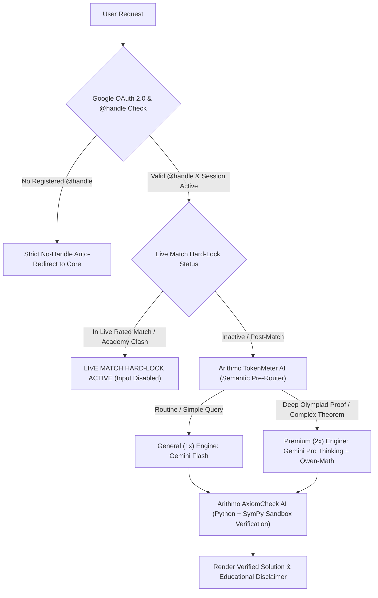

<div align="center">


# 🧠 Arithmo Personal AI — Context-Injected Olympiad Math Mentor

*Subsite #8 (`rayaantasnim.github.io/Arithmo-AI/`) • Hybrid `Gemini Pro/Flash + Qwen-Math` Engine • 15-ELO & 24h Telemetry Memory • Dual-Mode Semantic Routing*

[](https://rayaantasnim.github.io/Arithmo-AI/)
[](https://rayaantasnim.github.io/Arithmo-AI/)
[](https://rayaantasnim.github.io/Arithmo-AI/)
[](https://rayaantasnim.github.io/Arithmo-AI/)
[](https://rayaantasnim.github.io/Arithmo-AI/)
[](https://rayaantasnim.github.io/Arithmo-AI/)

</div>

---

## 1. Executive Overview & System Objective

**Arithmo Personal AI** is the dedicated personal artificial intelligence and Olympiad math mentor subsite hosted at **Subsite #8 (`rayaantasnim.github.io/Arithmo-AI/`)**, proudly powered by **Olympiad Edge**. Designed specifically for high-achieving mathletes, competition contenders, and academy scholars, it blends bleeding-edge generative transformer models with rigorous deterministic verification engines and deeply personalized telemetry memory.

Unlike general-purpose conversational agents, Arithmo Personal AI acts as a tailored personal tutor that knows your exact rating profile, understands your specific contest weak points, respects strict competitive integrity constraints during live matches, and provides flexible access models tailored to every budget.

---

## 2. Core Architecture, Access Gate & Mermaid Topology

The structural topology of **Arithmo Personal AI (`Subsite #8`)** integrates tightly with the unified ecosystem across authentication, live match monitoring, and deterministic mathematical verification.



### Key Architectural Layers:
1. **Mandatory `@handle` Onboarding Gate:** Access requires Google OAuth 2.0 (Gmail SSO) paired with a verified personal `@handle` registered on the **Arithmo-Edge Core Portal**. Unregistered users trigger the **Strict No-Handle Auto-Redirect** back to the core portal.
2. **Hard-Lock During Live Rated Matches:** Whenever a user enters a live rated contest (`Subsite #6`), 1v1 Bullet Blitz match, or Academy Clash Championship, **Arithmo Personal AI** instantly locks its chat input (`LIVE MATCH HARD-LOCK ACTIVE`) until the match concludes, completely preventing real-time AI assistance or cheating.
3. **Hybrid Neural + Deterministic Math Pipeline:**
   - **Semantic Pre-Router (`Arithmo TokenMeter AI`):** Evaluates duplicate intent, batch sizing, and complexity before execution.
   - **Dual Compute Engines:** Routes standard queries to **`General (1x)`** (`Gemini Flash`) and deep Olympiad proofs to **`Premium (2x)`** (`Gemini Pro Thinking + Qwen-Math Hybrid` with ultra-low latency and top server queue priority).
   - **Deterministic `Python + SymPy` Sandbox (`Arithmo AxiomCheck AI`):** Verifies algebraic, modular, and number-theoretic calculations in Python prior to rendering the final proof, eliminating AI hallucinations.
   - **Educational Disclaimer:** Displays a non-intrusive academic disclaimer beneath the chatbox reminding students to verify complex proofs independently.

---

## 3. Expandable Deep-Dive Modules

<details>
<summary><b>Dropdown 1: Context-Injected Personal Memory & V10.3 Smart Mistake Deck</b></summary>

### Personalized Coaching Mechanics
Arithmo Personal AI functions as an individualized Olympiad coach rather than a generic text assistant through deep telemetry integration:
- **15-ELO & Telemetry Context Injection:** Before every interactive session, the Cloudflare Worker securely injects the user's running **10 Core Arena ELOs** (`General + Expert` across all 5 distinct arenas), **Overall All-Rounder Rating**, **`Contribution ELO`**, and recent solve-time/backspace telemetry pulled directly from the **Hot Firestore DB** and the **24-Hour Private GitHub Archive Data Lake (`Zero-PII` JSONL vectors)**.
- **Post-Contest Post-Mortem & Solve-Time Heatmaps:** Automatically analyzes completed contests to identify exact questions where the user stalled, backspaced repeatedly, or fell into classic edge-case traps.
- **`V10.3` AI Smart Mistake Deck:** Automatically converts missed contest problems and weak Olympiad tags (e.g., `#Modular-Arithmetic`, `#Pigeonhole`, `#Vieta-Jumping`) into a **7-day spaced-repetition flashcard deck** for targeted retention and mastery.
- **Anti-Leak Retrieval Isolation (`Prompt Injection Protection`):** Upcoming unreleased problems stored in the Co-Founders' **Golden GitHub Repository** are strictly excluded from the chat retrieval index, ensuring that prompt-injection attacks can never leak future contest questions.

</details>

<details>
<summary><b>Dropdown 2: Personal Subscription Quotas & Pay-As-You-Go AI Packs</b></summary>

### A. Monthly Personal Subscription AI Allocations
*(Includes a 7-Day One-Time Free Trial on all paid subscription tiers)*

- **1. Free Tier (`$0.00 / month`):**
  - **`5` monthly questions** on **`Arithmo Personal AI: General (1x)`** with standard server queue priority.

- **2. Plus Tier (`$2.99 / month`):**
  - **`40` monthly questions** on **`Arithmo Personal AI: General (1x)`** with an ad-free workspace and standard queue acceleration.

- **3. Pro Tier (`$5.99 / month` — Most Popular):**
  - **`150` monthly questions** total, inclusive of **`30` `Premium (2x)` Deep Analysis tokens** + `120` `General (1x)` tokens.
  - Features weekly AI weakness diagnostics and full **Smart Mistake Deck** access.

- **4. Singularity Tier (`$12.99 / month` — Also Granted Automatically to `Academy Supreme` & `Academy Enterprise` Members):**
  - **100% UNLIMITED access** to **`Arithmo Personal AI: Premium (2x)`**, featuring Hybrid Generative AI Models, Deep Proof Analysis, Ultra-Low Latency, and Top Server Queue Priority.

### B. Standalone Pay-As-You-Go AI Packs
*(Managed via the **Personal Arithmo Wallet** — Zero Expiration on Purchased Token Packs)*

- **1. AI General Starter Pack (`$0.99` — One-Time):**
  - **`20` permanent no-deadline tokens** for **`Arithmo Personal AI: General (1x)`**.

- **2. AI Premium 2x Deep Pack (`$2.99` — One-Time):**
  - **`30` permanent no-deadline tokens** for **`Arithmo Personal AI: Premium (2x)`** (Deep Proof Analysis, Hybrid Models, and High Queue Priority).

- **3. 24-Hour AI Grandmaster Sprint (`$3.99` — One-Time):**
  - **`24` hours of UNLIMITED access** to **BOTH `General (1x)` and `Premium (2x)`** models simultaneously.

- **4. Deep Contest Post-Mortem & Mistake Deck Pass (`$0.99` — One-Time):**
  - Unlocks a complete solve-time heatmap, weak-topic diagnostic report, and **50-card spaced-repetition flashcard deck** for any single completed contest.

- **5. Wallet Credit Top-Up & `@handle` Gifting:**
  - Loading `$5`, `$10`, `$25`, or `$50` into the **Personal Arithmo Wallet** instantly awards an **`+10%` free bonus credit**.
  - Any standalone AI token pack or 24-hour Sprint pass can be gifted directly to another user's `@handle`.

</details>

<details>
<summary><b>Dropdown 3: In-Chat Dual-Model Selector Pop-up, Dynamic Default Routing & Semantic Token Metering</b></summary>

### In-Chat Interaction Sequence
The following sequence diagram illustrates the step-by-step execution of a user query inside **Subsite #8**:

```mermaid
sequenceDiagram
    actor User as Mathlete
    participant UI as Subsite #8 Chat UI
    participant Router as Arithmo TokenMeter AI
    participant Sandbox as Python + SymPy Sandbox
    participant Model as Hybrid Engine (1x / 2x)

    User->>UI: Submit Mathematical Query / Prompt
    UI->>Router: Inspect Wallet Balance & Query Intent
    alt Active Credits for Both General & Premium
        Router->>UI: Trigger In-Chat Dual-Model Selector Pop-up
        User->>UI: Select Model (General 1x vs Premium 2x)
    else Auto-Default Routing
        Router->>Router: Semantic Classification (Routine vs Deep Proof)
    end
    Router->>Model: Dispatch Query Payload with Telemetry Context
    Model->>Sandbox: Execute & Verify Code / Calculations
    Sandbox--Code->Model: Return Verified Mathematical Proof
    Model-->>UI: Stream Formatted Response & Educational Disclaimer
    UI-->>User: Render Final Output & Deduct Metered Tokens
```

### Core Metering & Routing Rules:
1. **In-Chat Dual-Model Selector Pop-up:** When an account holds active credits or passes for **BOTH `General (1x)` and `Premium (2x)`** simultaneously (e.g., `Pro` subscribers or users who purchased both packs), opening the **Arithmo Personal AI** chatbox presents a clean model selection pop-up allowing immediate choice between `General` and `Premium`.
2. **Smart Dynamic Default Routing (`Auto-Default`):** If the user does not manually override the prompt pop-up, the semantic router automatically assigns the optimal default model:
   - *Routine Calculations, Definitions & Simple Hints* default to **`General (1x)`** to preserve valuable `Premium (2x)` tokens.
   - *Multi-Step Olympiad Proofs, Contest Post-Mortems & Complex Theorems* automatically default to **`Premium (2x)`** (Hybrid AI + Deep Analysis + Ultra-Low Latency).
3. **Dynamic Semantic Token Metering (`Arithmo TokenMeter AI`) & Payload Caps:**
   - **Duplicate Question Protection:** Asking the exact same question twice deducts only **`-1` token total** (`0` deduction on exact repeat).
   - **Multi-Query Batch Packing:** Packing $N$ distinct mathematical problems into a single message deducts **`-N` tokens**.
   - **Conversational Zero-Cost:** Greetings (`"Hi"`), acknowledgments (`"Thanks"`), and short follow-up clarifications deduct **`0` tokens**.
   - **Per-Message Token Caps:** Strict input/output character and token limits are enforced per message to prevent payload abuse.

</details>

<details>
<summary><b>Dropdown 4: Encrypted Soft-Pinch Deterrence Loop (`Arithmo Alert AI` Integration)</b></summary>

### Psychological Deterrence & Behavioral Alignment
Arithmo Personal AI functions as the non-accusatory psychological deterrence layer across the competitive ecosystem:
- **Encrypted GitHub Signal Ingestion:** Reads anonymized `hash_id` risk vectors written by **Arithmo Alert AI** into an **AES-256 encrypted JSON vault** located inside a private GitHub repository (flagging indicators such as `suspected_reselling`, `suspected_collusion`, or `suspected_elo_boosting`).
- **Non-Accusatory Subtle Pinch (`Soft-Pinch Warning`):** When a flagged user interacts with **Arithmo Personal AI**, the system never directly accuses them—preventing false-accusation embarrassment or potential liability. Instead, it naturally weaves a polite, indirect reminder of platform telemetry, pairwise match monitoring, or institutional verification rules into the conversation, gently prompting bad actors to self-correct their behavior immediately.

</details>

---

## 4. Mandatory Verbatim Footer

```html
Authorized by Rayaan Tasnim
© All Rights Reserved
© Arithmo-Edge
Powered by Olympiad Edge
```