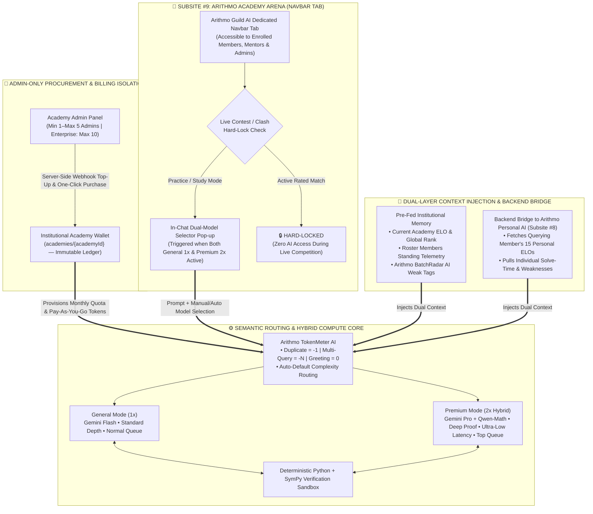
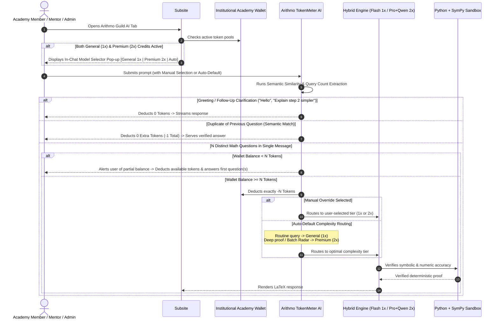

<div align="center">


# 🏫 Arithmo Guild AI — Institutional Academy Intelligence Engine

*Embedded Navbar Tab Inside Subsite #9 (`Arithmo Academy Arena`) • Admin-Only Wallet Procurement • Dual-Mode Hybrid AI (`General 1x` vs `Premium 2x`) • Semantic Token Metering*

<p>
  
  
  
  
  
  
</p>

</div>

---

## 🏛️ 1. Architectural Boundary & Institutional System Topology

**Arithmo Guild AI** is the dedicated institutional intelligence engine engineered specifically for schools, coaching institutes, math circles, and Olympiad academies operating inside **Subsite #9: Arithmo Academy Arena** (*Powered by Olympiad Edge*).

### 🔀 Structural Distinction: `Arithmo Guild AI` vs. `Arithmo Personal AI`

| Architectural Dimension | 🏫 `Arithmo Guild AI` (Institutional) | 🧠 `Arithmo Personal AI` (Individual) |
| :--- | :--- | :--- |
| **Deployment Location** | **Embedded Navbar Tab** directly inside **Subsite #9 (`Arithmo Academy Arena`)** | Standalone dedicated **Subsite #8 (`Arithmo Personal AI Portal`)** |
| **Primary Context Scope** | **Dual-Layer Context:** Pre-fed with institutional **Academy ELO**, global academy rank, roster `Members Standing`, and collective weak tags, **plus** real-time backend fetch of the individual querying member's personal telemetry | **Individual Context:** 15 personal ELO ratings, individual `24h` solve-time telemetry, personal weak tags, and `AES-256` soft-pinch deterrence signals |
| **Procurement & Billing** | **Strictly Admin-Only** via the isolated **Institutional Academy Wallet** (`academies/{academyId}`) | Individual users via Personal Arithmo Wallet / individual subscription tiers |
| **Access Eligibility** | All enrolled members, mentors, and admins of an active academy (`General`, `Premium`, `Supreme`, `Enterprise`) | Individual registered students and educators on `Subsite #8` |
| **Live-Match Security** | **Hard-Locked (`HARD-LOCKED`)** whenever any member or academy roster enters a live rated contest or **Inter-Academy Clash Championship** | **Hard-Locked (`HARD-LOCKED`)** during any live rated contest or `1v1` duel |

### 🗺️ Institutional Neural Topology & Backend Bridge



---

## 📂 2. Expandable Deep-Dive Specifications

<details open>
<summary><b>📊 1. 4-Tier Academy Sub-Package AI Quotas, Quality Scaling & Dynamic Enterprise Expansion</b></summary>
<br />

Unlike flat-rate SaaS tools that only vary message counts, **Arithmo Guild AI** scales across **five distinct engineering axes** depending on the institution's active Academy Sub-Package:
1. **Monthly Message/Token Quota**
2. **Mathematical Proof Depth**
3. **Generative Model Hybridity**
4. **Inference Latency**
5. **Server Queue Priority**

### 📋 Complete 4-Tier Institutional AI Matrix

| Academy Sub-Package | Monthly Subscription | Member Capacity | Monthly `Arithmo Guild AI` Quota | Analytical Depth, Latency & Server Queue Profile | Exclusive Institutional AI Features |
| :--- | :---: | :---: | :---: | :--- | :--- |
| **1. Academy General** | **`$29.99 / mo`** | Max **`100`** Members | **`20` messages / month** | **Standard Analysis Depth** • Standard inference latency • Normal server queue priority | Pre-fed Academy ELO & global rank context; individual member ELO fetch |
| **2. Academy Premium** | **`$49.99 / mo`** | Max **`500`** Members | **`80` messages / month** | **Medium-to-Deep Analysis** • Accelerated response latency • Elevated server queue priority | Unlocks **AI Weak-Topic Batch Radar (`Arithmo BatchRadar AI`)** scanning up to `500` members |
| **3. Academy Supreme** | **`$79.99 / mo`** | Max **`1,000`** Members | **`200` messages / month** | **Maximum Deep Proof Analysis** • **Ultra-Low Latency** • **Hybrid AI (`Gemini Pro + Qwen-Math`)** • **Top Queue Priority** | Full Batch Radar + **Free Unlimited `Virtual Edu Lab`** with real-time AI mathematical fact-checking |
| **4. Academy Enterprise** | **`$149.99` (Month 1)**<br/>**`$79.99 / mo` Base** | **Unlimited** Members | **`200` Premium Tokens** + Dynamic Scaling | **Maximum Deep Proof Analysis** • **Ultra-Low Latency** • **Hybrid AI (`Gemini Pro + Qwen-Math`)** • **Top Queue Priority** | Automatic dynamic quota expansion beyond `1,000` members + `Max 10 Admins` governance |

### 🧮 Academy Enterprise Dynamic Quota Formula

For institutions exceeding `1,000` enrolled members under **Academy Enterprise**, the monthly premium token pool expands automatically according to:

$$\text{Monthly Guild AI Tokens} = 200 + \left\lfloor \frac{\max(0, N_{\text{members}} - 1000)}{50} \right\rfloor \times 15$$

* **Baseline (`1` to `1,000` Members):** `200` Premium tokens/month.
* **Incremental Expansion (`> 1,000` Members):** Every full block of **`50` additional members** automatically injects **`+15` Premium tokens/month** into the institutional pool.

```text
+-------------------------------------------------------------------------------+
|                 ACADEMY ENTERPRISE DYNAMIC SCALING EXAMPLES                   |
+-----------------------+---------------------------+---------------------------+
| Enrolled Roster Size  | Additional Blocks (+50)   | Monthly Premium AI Quota  |
+-----------------------+---------------------------+---------------------------+
| 1,000 Members         | 0                         | 200 Premium Tokens        |
| 1,250 Members         | 5 blocks (+75 tokens)     | 275 Premium Tokens        |
| 2,000 Members         | 20 blocks (+300 tokens)   | 500 Premium Tokens        |
| 5,000 Members         | 80 blocks (+1,200 tokens) | 1,400 Premium Tokens      |
+-----------------------+---------------------------+---------------------------+
```

</details>

---

<details open>
<summary><b>🏦 2. Admin-Only Procurement Governance & Institutional Academy Wallet Isolation</b></summary>
<br />

### 🔐 Strict Role-Based Financial & Procurement Isolation

Every registered institution operates under an isolated cryptographic namespace (`academies/{academyId}`) with a dedicated **Institutional Academy Wallet**:

* **Zero Member/Mentor Purchase Rights:** Regular academy **Members** and **Mentors (`Min 1 – Max 15`)** are strictly barred from purchasing monthly subscriptions, extra token packs, or 48-hour unlimited passes for **Arithmo Guild AI**.
* **Exclusive Admin Panel Authority:** Only authorized officers inside the **Academy Admin Panel** (`Min 1 – Max 5 Admins` in General/Premium/Supreme; `Max 10 Admins` in Enterprise) can deposit funds into the **Academy Wallet** and authorize one-click AI procurement.
* **Cryptographic Webhook & Audit Ledger:**
  * Wallet balances can only be credited via verified **server-side payment gateway webhooks** (preventing client-side tampering).
  * Every top-up and AI credit deduction records an **immutable audit log** capturing the exact `admin_id`, UTC timestamp, item SKU, and USD/credit delta.

### 📜 Institutional Billing, No-Refund & Renewal Ultimatum Policy

1. **1-Month Minimum Billing Cycle:** All Academy Sub-Packages operate on a strict 30-day billing cycle.
2. **Zero-Refund Policy:** Once an Academy Sub-Package or `Arithmo Guild AI` Pay-As-You-Go top-up is provisioned via the Academy Wallet, all transactions are final and non-refundable.
3. **5-Day Renewal Grace Ultimatum:** If an academy's monthly subscription expires without sufficient balance in the Academy Wallet, the institution enters a strict **5-Day Renewal Grace Ultimatum** before institutional dissolution and suspension of `Arithmo Guild AI` access.

</details>

---

<details open>
<summary><b>💳 3. Dual-Mode Pay-As-You-Go Store (General 1x vs. Premium 2x)</b></summary>
<br />

When an institution exhausts its included monthly message quota—or requires immediate surge capacity before a major Olympiad—Academy Admins can purchase standalone **Pay-As-You-Go** top-ups through the **Academy Wallet** across two distinct compute tiers:

* **`Arithmo Guild AI: General` (`1x` Base Price):** Powered by `Gemini Flash` with standard analytical depth and normal server queue priority.
* **`Arithmo Guild AI: Premium` (`2x` Price):** Costs exactly double `General (1x)` and unlocks **Deep Multi-Lemma Proof Analysis**, **Ultra-Low Latency**, **Hybrid Generative AI (`Gemini Pro + Qwen-Math`)**, and **Top Server Queue Priority**.

| Pay-As-You-Go Top-Up SKU | `Arithmo Guild AI: General` (`1x` Base Tier) | `Arithmo Guild AI: Premium` (`2x` Hybrid Ultra-Low Latency Tier) | Expiration & Rollover Rules |
| :--- | :---: | :---: | :--- |
| **15 Permanent Tokens Pack** | **`$3.99 USD`** | **`$7.99 USD`** | **No Deadline** — Permanent tokens never expire and remain in the Academy Wallet until consumed. |
| **48-Hour Unlimited Academy Pass** | **`$7.99 USD`** | **`$14.99 USD`** | **48 Hours** — Unlocks unlimited queries for the entire academy roster for 48 consecutive hours. |

> **Anti-Abuse Payload Guardrail:** Both monthly included quotas and Pay-As-You-Go token packs enforce strict per-message input/output character and token caps to prevent automated prompt-stuffing or bulk scraping abuse.

</details>

---

<details open>
<summary><b>⚡ 4. In-Chat Dual-Model Selector Pop-up, Dynamic Default Routing & Semantic Token Metering</b></summary>
<br />

### 🔄 Runtime Prompt Execution & Semantic Metering Sequence



### 🎛️ Three Core Runtime Intelligence Mechanisms

1. **In-Chat Dual-Model Selector Pop-up:**
   * Whenever an academy's wallet holds active credits or passes for **both `General (1x)` and `Premium (2x)`** simultaneously, opening the **Arithmo Guild AI** interface presents a clean **Model Selector Pop-up**, empowering the user to explicitly select `General` or `Premium`.
2. **Smart Dynamic Default Routing (`Auto-Default`):**
   * If the user leaves the selector on automatic mode, `Arithmo TokenMeter AI` evaluates prompt complexity in real time:
     * **Routine Calculations & Concept Lookups:** Automatically routes to **`General (1x)`** to preserve the academy's `Premium (2x)` reserve.
     * **Complex Olympiad Proofs, Multi-Lemma Deductions & Batch Radar Diagnostics:** Automatically engages **`Premium (2x)`** (Deep Analysis + Hybrid AI + Top Queue Priority).
3. **Dynamic Semantic Token Metering (`Arithmo TokenMeter AI`):**
   * **Duplicate Question Protection (`-1` Total):** If a user accidentally submits the same problem twice due to network lag or minor rewording, semantic similarity detection prevents double billing—charging **`-1` token total**.
   * **Multi-Query Extraction (`-N` Tokens):** If a single message bundles $N$ distinct mathematical problems, the engine parses each distinct sub-query and deducts **`-N` tokens** proportionally (if insufficient tokens remain, it notifies the user and answers only as many questions as remaining tokens cover).
   * **Conversational Zero-Cost (`0` Tokens):** Greetings (`"Hello"`, `"Thanks"`) and short follow-up clarifications (`"Can you simplify step 3?"`) incur **`0` token deductions**.

</details>

---

<details open>
<summary><b>🔬 5. Institutional Capabilities (Batch Radar, Virtual Edu Lab & Role-Based Guardrails)</b></summary>
<br />

### 📡 1. AI Weak-Topic Batch Radar (`Arithmo BatchRadar AI`)
* **Roster-Wide Weakness Synthesis:** Available in **Academy Premium**, **Supreme**, and **Enterprise**, `Arithmo Guild AI` aggregates `Members Standing`, contest accuracy, and solve-time latency across the entire academy roster.
* **Actionable Curriculum Diagnostics:** Mentors and Admins can query batch-level blind spots directly (e.g., *"Analyze our roster's performance in last week's Number Theory qualifier"*) and receive targeted diagnostic breakdowns (e.g., *"65% of your roster struggles with Modular Arithmetic order arguments and Pigeonhole Principle constructions"*).

### 🧪 2. Real-Time `Virtual Edu Lab` Silent Moderation & Fact-Checking
* **Access Tiers:** Unlocked **free and unlimited** for **Academy Supreme** and **Academy Enterprise**; available on-demand via a **`$2.99 USD` 24-Hour Pass** from the Academy Wallet for **Academy General** and **Academy Premium**.
* **Silent Background Analysis:** Inside the live `LaTeX`-enabled collaborative math room, the `Arithmo AI (Gemini + Qwen-Math Hybrid)` engine silently monitors every equation and proof step without interrupting valid peer discussions.
* **Critical False-Math Intervention:** The moment any student, mentor, or admin posts a **critical mathematical fallacy, false theorem, or broken proof**, the AI intervenes directly inside the chatroom—flagging the exact logical flaw and presenting a rigorous **counterexample** so misconceptions never spread across the cohort.

### 🛡️ 3. Strict Role-Based Experience (`Admin` vs. `Mentor` vs. `Members`)
* **Academy Admins (`1–5` | `10` in Enterprise) & Mentors (`1–15`):**
  * Full access to roster-wide `Batch Radar` analytics, `Members Standing` diagnostics, curriculum pacing insights, and automated `Task` homework problem generation.
* **Academy Members:**
  * Receive personalized Socratic Olympiad guidance calibrated to both their individual ELO (`Subsite #8` bridge) and their academy's training track—with **strict anti-spoiler guardrails** that refuse to leak solutions to active academy contests or assigned Mentor `Task` evaluations.

</details>

---

<div align="center">

---

**Authorized by Rayaan Tasnim**  
&copy; All Rights Reserved  
&copy; Arithmo-Edge  
*Powered by Olympiad Edge*

</div>