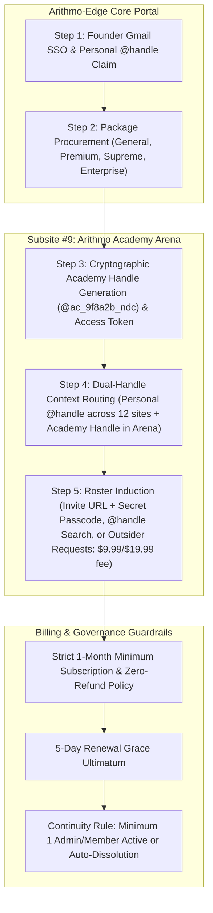

<div align="center">

# 🏫 Arithmo Academy Packages — 4-Tier Institutional Ecosystem

**Subsite #9 (`Arithmo Academy Arena`) • 3-Role Hierarchy (`Admin`, `Mentor`, `Members`) • Dual-Handle Context Routing • Anti-Reselling Shield**

[](https://arithmo-edge.io)
[](https://arithmo-edge.io)
[](https://arithmo-edge.io)
[](https://arithmo-edge.io)
[](https://arithmo-edge.io)
[](https://arithmo-edge.io)


</div>

---

## 🏛️ Institutional Architecture & Mermaid Onboarding Flow

The institutional onboarding and routing lifecycle within **Subsite #9 (`Arithmo Academy Arena`)** is powered by a robust 7-step process ensuring cryptographically secure context separation and role management.



---

## 📂 Deep-Dive Institutional Specifications

<details>
<summary><b>📖 Dropdown 1: The 4 Institutional Academy Packages (Complete Non-Table Breakdown)</b></summary>

### 1. Academy General
- **Target Audience:** School Clubs & Small Coaching Batches
- **Institutional Pricing:** `$29.99 USD / month`
- **Roster & Role Limits:** Maximum **`100` members**, **`1–5` Admins**, and **`1–15` Mentors**.
- **Mandatory Monthly Member Fee:** Admins' monthly fee is waived (`$0`). Every regular member must pay **`$0.99 USD / month`** via their personal `Arithmo Wallet` to maintain active status (subject to removal after the grace period).
- **Equivalent Personal Perks & Profile Badge:** Regular members and mentors receive **`Plus` (`$2.99`)** privileges and display the **`Plus`** badge on their public profiles. **ONLY Admins** display the official **`Academy General`** badge.
- **Core Features:** Internal academy standings, CSV/PDF auto-attendance & progress reports, computer lab IP whitelisting (preventing false `Module 7` collusion flags on shared Wi-Fi networks), `Task` homework assignment system, and **`20` monthly `Arithmo Guild AI`** messages.

---

### 2. Academy Premium
- **Target Audience:** Colleges & Regional Olympiad Camps
- **Institutional Pricing:** `$49.99 USD / month`
- **Roster & Role Limits:** Maximum **`500` members**, **`1–5` Admins**, and **`1–15` Mentors**.
- **Mandatory Monthly Member Fee:** Admins' monthly fee is waived (`$0`). Every regular member must pay **`$2.99 USD / month`** to remain active in the academy.
- **Equivalent Personal Perks & Profile Badge:** Regular members and mentors receive **`Premium` (`$5.99`)** privileges and display the **`Premium`** badge on their public profiles. **ONLY Admins** display the official **`Academy Premium`** badge.
- **Core Features:** Everything in General, plus **`80` monthly `Arithmo Guild AI`** messages, **AI Weak-Topic Batch Radar** (`Arithmo BatchRadar AI`), custom branded academy profile with logo upload, bulk `@handle` import tools, and eligibility for irregular **Inter-Academy Clash Championships** (`$4.99` one-time registration fee).

---

### 3. Academy Supreme
- **Target Audience:** Universities & Large Olympiad Academies
- **Institutional Pricing:** `$79.99 USD / month`
- **Roster & Role Limits:** Strictly capped at a maximum of **`1,000` members** (not unlimited), **`1–5` Admins**, and **`1–15` Mentors**.
- **Mandatory Monthly Member Fee:** Admins' monthly fee is waived (`$0`). Every regular member must pay **`$6.99 USD / month`** to remain in the academy.
- **Equivalent Personal Perks & Profile Badge:** Regular members and mentors receive **`Singularity` (`$12.99`)** privileges and display the **`Singularity`** badge on their public profiles. **ONLY Admins** display the official **`Academy Supreme`** badge.
- **All Pay-As-You-Go Features Included 100% FREE:** Includes **`200` monthly `Arithmo Guild AI`** messages, **FREE `Inter-Academy Clash Championship`** registration, **FREE `Academy Guidebook`** (`$14.99/mo` waived), **FREE on-demand private & mentor contests**, **FREE 24-hour `Virtual Edu Lab`**, live spectator dashboard, and co-branded QR-verified digital certificates.

---

### 4. Academy Enterprise
- **Target Audience:** National Federations & Mega Coaching Networks
- **Institutional Pricing:** `$149.99 USD` First Month, `$79.99 USD / month` Base Renewal
- **Roster & Role Limits:** **Unlimited members**, **`1–10` Admins**, and **`1–15` Mentors**.
- **Dynamic Mandatory Monthly Member Fee:** Admins' monthly fee is waived (`$0`). When the total roster size is **`< 1,000` members**, every regular member pays **`$5.99 USD / month`**. When the roster exceeds **`1,000` members**, delayed extra members pay **`$7.99 USD / month`**. Outsider join requests cost **`$19.99 USD`** one-time upon Admin approval.
- **Equivalent Personal Perks & Profile Badge:** All members and mentors receive **`Singularity`** privileges and display the **`Singularity`** badge on their public profiles. **ONLY Admins** display the official **`Academy Enterprise`** badge.
- **Dynamic `Arithmo Guild AI` Token Scaling:** Starts with **`200` premium tokens/month** up to `1,000` members, plus **`+15` premium tokens/month automatically added for every `50` extra members** above `1,000`—alongside all `Academy Supreme` free Pay-As-You-Go perks.

</details>

<details>
<summary><b>👥 Dropdown 2: 3-Role Institutional Hierarchy (`Admin`, `Mentor`, `Members`), `Task` Tab & Governance Rules</b></summary>

### 1. Admin Panel
- **Composition:** Minimum `1` to Maximum `5` Admins (`Max 10` in Enterprise). The initial purchaser automatically becomes the **Founder Admin**.
- **Promotion & Fees:** Regular members can apply for Admin promotion; upon approval by the Head/Founder Admin, the candidate pays a one-time **`$2.99` promotion fee** to unlock administrative privileges.
- **Privileges:** Only Admins can operate the **Institutional Academy Wallet**, execute package renewals, approve outside join requests, and display the official **`Academy`** badge on their public profile.
- **Voluntary Resignation Rule:** Any Admin (including the Founder) may step down voluntarily **only after appointing at least one successor Admin** to maintain continuity.

---

### 2. Mentor Panel & Dedicated `Task` Navbar Tab
- **Composition:** Every academy maintains **`1` to `15` Mentors** appointed by Admins to lead specialized Olympiad training tracks.
- **`Task` Navbar Tab Flow (`Task by Mentor` $\rightarrow$ `Submission by Members`):** 
  - Mentors publish structured homework problemsets complete with strict deadlines inside the dedicated `Task` tab.
  - Members submit step-by-step rigorous solutions tracked in real time by **`Arithmo ProofGrader AI`**.

---

### 3. Members & Dual Standing Tabs
- **`Academy Standing` Tab:** Global inter-academy leaderboard ranked by a **single indivisible `Academy ELO`** (calculated from team contest results combined with average member match performance).
- **`Members Standing` Tab:** Displays each member's rank **both inside their own Academy AND across the entire global Arithmo-Edge userbase simultaneously**.

</details>

<details>
<summary><b>⚔️ Dropdown 3: On-Demand Academy Contests, `Inter-Academy Clash`, `Virtual Edu Lab` & `Academy Guidebook`</b></summary>

- **Privacy Isolation Rule:** All academy contests appear **exclusively** inside `Subsite #9`'s `Contest` tab and remain **completely invisible** on public `Subsite #6 (Contest Section Portal)`.
- **3 On-Demand Academy Contests (`General` & `Premium` Pay-As-You-Go — `100% Free` for `Supreme` & `Enterprise`):**
  - **`$1.99` HQ-Composed Group Contest:** Team-based practice contest authored by Core HQ.
  - **`$4.99` HQ-Composed Private Room Single Contest:** Isolated academy-only contest room requested via HQ appeal.
  - **`$9.99` Mentor Self-Composed Problemset Contest:** Utilizes an isolated Arithmo Forge-style studio interface so Mentors can author and execute custom exams.
- **Inter-Academy Clash Championship:** Irregular, HQ-hosted Expert-Mode (Olympiad-level) inter-institutional championship (`$4.99` registration fee for Premium; free for Supreme & Enterprise; ineligible for General).
- **Virtual Edu Lab (`$2.99 / 24h` for General & Premium — Free for Supreme & Enterprise):** Real-time collaborative math chatroom monitored silently by Arithmo AI, which intervenes directly in chat if a critical false theorem or proof fallacy is posted.
- **Exclusive Academy Guidebook (`$14.99 / month` with 3-day grace period — Free for Supreme & Enterprise):** Deep HQ-authored Olympiad handbook. Any member or mentor whose contributed math is certified by Gemini and approved by HQ adds it globally across all academies and personally earns **`+2 Contribution ELO`** on their personal `@handle` (academies themselves hold no Contribution ELO).

</details>

<details>
<summary><b>🛡️ Dropdown 4: 5-Layer Anti-Reselling & Institutional Verification Shield (`Arithmo ResellerShield AI` + `AcademyKYB AI`)</b></summary>

To prevent dishonest actors from purchasing institutional packages and reselling discounted `Singularity` access to external outsiders, the ecosystem enforces 5 strict security layers:

1. **Institutional KYB Document Gate (`Arithmo AcademyKYB AI`):** Premium, Supreme, and Enterprise activations require verified school/college `.edu` domains, official trade licenses, or institutional letterheads audited by AI and `Subsite #12 (Headquarters Core)`.
2. **Geographic & Behavioral Cluster Audit (`Arithmo ResellerShield AI`):** Automatically flags fake shell academies if members are randomly scattered across unrelated regions without classroom IP clusters, or if the academy records zero Task homework submissions and zero internal contests.
3. **Strict 10%–15% Monthly Roster Churn Lock:** Caps monthly member additions and removals at `10%–15%` to block rapid user-swapping by resellers.
4. **Direct In-App Member Billing:** Mandatory monthly member fees (`$0.99`, `-$2.99`, `$6.99`, `$5.99/$7.99`) are billed directly inside the application via each member's personal `Arithmo Wallet`, eliminating off-platform cash collection by middlemen.
5. **Zero-Tolerance Dissolution & Soft-Pinch Deterrence:** Confirmed reselling triggers immediate, non-refundable academy dissolution and permanent Gmail/payment card bans. Early suspected anomalies receive non-accusatory soft-pinch warnings via `Arithmo Alert AI` $\rightarrow$ `Arithmo Personal AI`.

</details>

---

```html
Authorized by Rayaan Tasnim
© All Rights Reserved
© Arithmo-Edge
Powered by Olympiad Edge
```