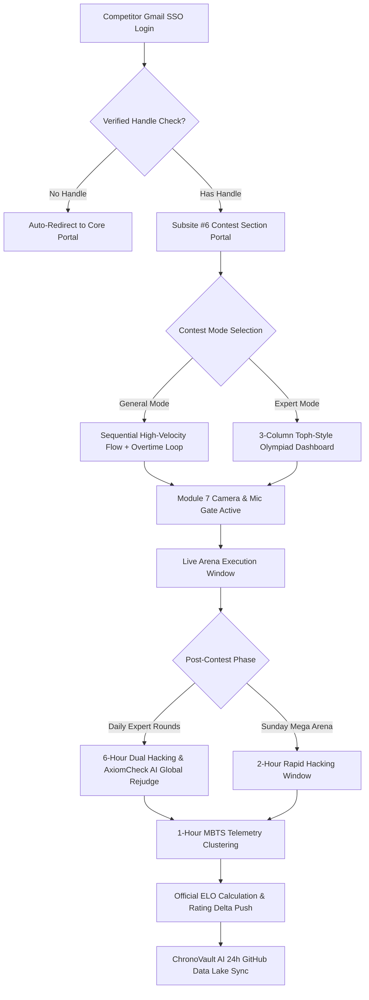

<div align="center">


# ⚔️ Arithmo-Edge Contest Mechanism & Olympiad Competition Engine

*Subsite #6 (`Contest Section Portal`) • 7-Day Zero-Rest Calendar • General Velocity Flow vs. Toph-Style Expert Dashboard • 6-Hour Dual Hacking • ELO-Rated 1v1 Bullet Blitz • `QPRT-4` Resilience*

<p>
  
  
  
  
  
  
</p>

</div>

---

## 2. End-to-End Contest Lifecycle & Mermaid Architecture

Arithmo-Edge operates through a rigorous, multi-tiered pipeline designed to ensure absolute competitive integrity, sub-millisecond telemetry synchronization, and zero-compromise security across public and institutional challenges.



### Unified Handle Gate & Topic Architecture
- **Unified Handle Gate:** Competitors must sign in via Gmail SSO with a verified `@handle`. Accounts lacking a provisioned handle are automatically rerouted to the Core Portal configuration utility before entering Subsite #6.
- **Topic & Tag Architecture:**
  - **Foundation Phase (`V3.4 – V10.3`):** Dedicated rounds across the **5 Core Number Theory Arenas** (*Prime Factors, GCD-LCM, Numbers of Divisor, Square Root, Sum of Divisors $\sigma(N)$*) enforcing the **Strict No-Mixed ELO Policy** (`10 Core ELOs` = `5 General + 5 Expert`).
  - **Mega-Hub Phase (`V11.0+`):** Unifies into **4 Core IMO Hubs** (*Number Theory, Algebra, Combinatorics, Geometry*) with filterable Olympiad tags (`#Modular-Arithmetic`, `#Pigeonhole`, `#Vieta-Jumping`, `#Radical-Axis`) that remain **hidden during live matches** and unlock in post-contest practice.
- **Privacy Isolation of Academy Contests:** Institutional contests (`Inter-Academy Clash`, HQ group/private rooms, and Mentor problemsets) appear **exclusively** inside `Subsite #9 (Academy Arena)` and never appear on public `Subsite #6`.

---

## 3. Expandable Deep-Dive Sections

<details>
<summary><b>Dropdown 1: 7-Day Rotational Contest Calendar (STRICTLY NO REST DAY!) & Sunday Mega Contest</b></summary>

The Arithmo-Edge calendar maintains continuous competitive momentum 365 days a year with zero rest days, structured across daily topic rounds, weekly Saturday special series, and the high-stakes Sunday Mega Arena.

- **Monday – Friday (Daily Topic Rounds & Sequential Indexing):**
  - **Monday:** *Prime Factor Round `#1`, `#2`...*
  - **Tuesday:** *GCD-LCM Round `#1`, `#2`...*
  - **Wednesday:** *Numbers of Divisor Round `#1`, `#2`...*
  - **Thursday:** *Square Root Round `#1`, `#2`...*
  - **Friday:** *Sum of Divisors $\sigma(N)$ Round `#1`, `#2`...*
  - **Daily Dual Timings:** **Expert Mode** launches at **`17:00 UTC`** (`0+ ELO` open eligibility); **General Mode** launches at **`20:00 UTC`**.
- **Saturday (Special Theme Episodes — Rotating Weekly Series):**
  - *IMO Simulation Episode `#1`*, *Number Theory Contest `#1`*, *Arithmo Special `#1`*, *Olympiad Challenge `#1`*, and *Math Query `#1`*.
- **Sunday (NO REST DAY — Sunday Mega Arena Contest):**
  - **Exclusive Core HQ Authorship:** Prepared solely by the **Core HQ Team**, spotlighting a single arena (e.g., *Prime Factor Decompositions*) or mixed Olympiad synthesis in `V11.0+`.
  - **Default Expert Mode Only:** No General/Expert mode choice—all competitors enter the unified **Default Expert Mode** interface.
  - **Open Eligibility:** Open to all rated competitors worldwide alongside an optional **Unrated** registration toggle.
  - **Match Parameters & Fast Finalization:** **`100` minutes**, **`10` questions**, strict **Max `2` submissions per question**, followed by a **`2-hour` Hacking Session** + **`1-hour` MBTS** = **Final official results & ELO updates at `T+3 hours`**.

</details>

<details>
<summary><b>Dropdown 2: Multi-Stage Registration Flow, 4 Segment Cards & Forced Unrated Policy</b></summary>

Entering any competition on Subsite #6 requires navigating a strict 5-step registration pipeline governed by bracket caps and rating prerequisites.

### 5-Step Registration Pipeline
1. **Upcoming Events List:** Browse scheduled rounds on `Subsite #6`.
2. **Dedicated Event Page:** Select either **`General Mode`** or **`Expert Mode`**.
3. **Expandable 4 Segment Cards:** Clicking a mode expands **4 ELO-bracketed Segment Cards** (*Initiate / Contender / Advanced / Finalist* for General; *Apprentice / Intermediate / Vanguard / Apex* for Expert).
4. **Dedicated Segment Contract Page:** Displays exact problem count, duration, point weights (`100–1000` pts), and the binding **Module 7 + MBTS Legal Contract**.
5. **Final Registration Choice:** Choose **`Register as Rated`** vs. **`Register as Unrated`**.

### Forced Unrated Registration Rule
If a user's running ELO exceeds the selected segment's maximum rating cap (`>1199`, `>1799`, or `>2399`), the **`Register as Rated`** button is forcibly disabled—allowing entry strictly via **Forced Unrated Registration**.

### Cross-Mode Dual Registration Rule
Competitors **CAN** register for **BOTH** `General` and `Expert` in the same event (since they run at separate UTC hours), but **CANNOT** register for more than one segment within the same mode.

</details>

<details>
<summary><b>Dropdown 3: General Arena UI vs. Expert Arena UI (Complete Non-Table Breakdown)</b></summary>

Arithmo-Edge deploys two distinct user interfaces tailored to distinct cognitive competition styles.

### 1. General Mode UI (`exam.html` High-Velocity Sequential Flow)
- **Top Telemetry HUD:** Compact cyber-bar showing current arena/hub badge, live countdown timer, active score & combo streak (`Combo x4`), and progress counter (`Question 3 / 15`).
- **Single-Problem Focus Card:** Displays strictly **one question at a time** in a clean Glassmorphism card with zero sidebars.
- **No Back-Review & Second-Chance Overtime Loop:** Competitors cannot navigate backward to previous problems without submitting or skipping (`Skip for Overtime`). All missed or skipped questions automatically return at the end in a **Second-Chance Overtime Loop**.
- **Zero-Mouse & Mobile Touch Numpad:** Desktop supports instant `Enter` submission; mobile devices render a custom fixed **Cyber Touch Numpad** (`0–9`, `-`, `/`, `^`, `⌫`, `SUBMIT`) eliminating mobile keyboard bounce.
- **Zen Focus Mode Toggle:** Hides scoreboard, rank deltas, and HUD animations so only the question, timer, and input box remain visible.

### 2. Expert Mode UI (3-Column `Toph.co`-Style Olympiad Dashboard)
- **Left Sidebar:** Displays contest title, live status timer, **`Dashboard`** overview button, clickable problem index list (**`A, B, C, D, E...`**), and **`Announcements`** tab.
- **Center Workspace:** Displays full problem list with titles, statements, real-time solve ratios (e.g., `12/72`), and the individual problem submission workspace.
- **Right Live Feed:** Real-time **HQ `Announcements`** and clarification notice board.
- **Free Navigation & Strict Max 2 Submissions:** Competitors can freely jump between any problem `A..Z` in any order at any time, but every problem enforces a **strict maximum of `2` submission attempts**—a second wrong submission permanently locks that question.

</details>

<details>
<summary><b>Dropdown 4: Post-Contest 6-Hour Dual Hacking, Global Rejudge & ELO Calculation</b></summary>

- **6-Hour Dual Hacking Window (Regular Daily Expert Rounds):** Opens immediately after match end before `1 hour` of `MBTS` telemetry clustering (`Finalization at T+7 hours`):
  1. **Problem / Edge-Case Hacking (`+25 to +100 pts` + Global Rejudge):** Discovering a missing mathematical edge case or judge-key flaw triggers an automatic **`2-minute` `AxiomCheck AI` + `Python/SymPy` Global Rejudge** across all submissions and awards **`+25 to +100` scoreboard points**.
  2. **Opponent Submission Hacking (`+5 to +50 pts` / `-10 pts` Penalty):** Exposing a valid counterexample against another competitor's accepted submission awards **`+5 to +50 pts`** on success, or deducts **`-10 pts`** on a failed hack attempt.
- **Anti-Spam Hacking Cooldown:** Enforces a mandatory **`15-second` cooldown** between hack attempts and a **`10-minute` lockout** after `3` consecutive failed hacks.
- **System Expectation Override (`+ΔR` Underdog Protection):** Underdogs who lose narrowly against significantly higher-rated opponents still earn **positive ELO (`+ΔR`)** if their solve accuracy and millisecond speed outperform the system's expected performance curve.

</details>

<details>
<summary><b>Dropdown 5: ELO-Rated `1v1 Bullet Blitz`, Direct Challenges, `Virtual Gym` & `Annual World Cup`</b></summary>

### 1. ELO-Rated 1v1 Bullet Blitz & Direct Friend Challenges (Subsite #6)
- **Direct ELO Impact:** Both Random Global Pool ($\pm 100$ ELO) matches and Direct `@handle` / Link Friend Challenges directly update the specific topic arena's ELO (Strict No-Mixed ELO Policy + System Expectation Override).
- **Anti-Boosting Guard (Pairwise ELO Cap):** Only the first 2 matches within 24 hours between the exact same two opponents are rated; from the 3rd match onward they automatically become unrated, and direct challenges with $> \pm 250$ ELO gap are unrated.
- **Economy & Fallback:** Free users receive 5 lifetime free global pool challenges (Plus: 5/day; Pro: 20/day; Singularity: unlimited). Creating a Direct Friend Challenge requires Pro, Singularity, or a Duelist 5-Pack ($0.99) (includes a 30-minute expiration with one-click Global Pool Fallback), while accepting is 100% Free.
- **Cold-Start Shadow Sparring (Arithmo ShadowBot AI):** If no human opponent is found in unrated practice pools within 10 seconds, an ELO-matched human-paced sparring bot deploys automatically.

### 2. Virtual Participation (Virtual Gym on Subsites #1–#5)
- **Ghost Leaderboard Simulation:** Replays historical live contests timestamp-by-timestamp, inserting the participant onto the live scoreboard with a `[Virtual]` badge.
- **Unrated + Simulated ELO Delta:** Never alters official ELO, but computes an accurate Simulated ELO Delta (`+45` / `-20`), includes optional Module 7 proctoring and offline Practice Hack, and supports Solo Mode (Free) plus Private Group Rooms (Pro: max 10 members; Singularity: unlimited).

### 3. V10.1 Annual World Cup (Top 128 Progressive Half-Elimination)
- Invites the world's Top 128 competitors into a high-stakes 6-round Progressive Half-Elimination Bracket (128 $\rightarrow$ 64 $\rightarrow$ 32 $\rightarrow$ 16 $\rightarrow$ 8 $\rightarrow$ 4 $\rightarrow$ Champion), awarding permanent rotating Golden Crowns ($\text{👑}$) on profiles and Standings.

</details>

<details>
<summary><b>Dropdown 6: QPRT-4 Quad-Phase Contest Resilience & Anti-Cheat Shield</b></summary>

The Arithmo-Edge Quad-Phase Resilience Theory (`QPRT-4`) safeguards competitive integrity across four immutable pillars:

- **Phase I (Pre-Exam):** PlagioGuard AI blocks $>75\%$ AoPS similarity; AxiomCheck AI runs 100% Python/SymPy verification; AdversarialRedTeam AI rejects any problem solvable directly by standard LLMs; QuantumShuffler AI locks 2 standby backup problems per segment; Module 7 verifies active camera & microphone streams.
- **Phase II (In-Exam):** GridShield AI freezes contest clocks (`FROZEN`) after 30s server lag and adds exact recovery time; IndexedDB Offline Vault caches millisecond-stamped submissions; PulseWatcher AI quarantines leaked/flawed problems and hot-swaps reserve problem A2 within 30 seconds (`+10 min` bonus time); Module 7 enforces 4.5s Adaptive Gaze Guard and 3-axis Neural Audio Trap.
- **Phase III (Post-Exam):** 6h Dual Hacking + 2-min Global Rejudge; 1h MBTS telemetry clustering; Asymmetric Fair-Play ELO Shield (Zero-Gain / Safe-Rollback on severely compromised rounds); 11-Flag Blackhole Lockdown Ladder + 4-Step Forensic Appeal with 5-Min Live Skill Audit.
- **Phase IV (Post-Cycle):** ChronoVault AI pushes Zero-PII cognitive vectors (`.jsonl`) to the private GitHub Data Lake every 24 hours.

</details>

---

```html
Authorized by Rayaan Tasnim
© All Rights Reserved
© Arithmo-Edge
Powered by Olympiad Edge
```