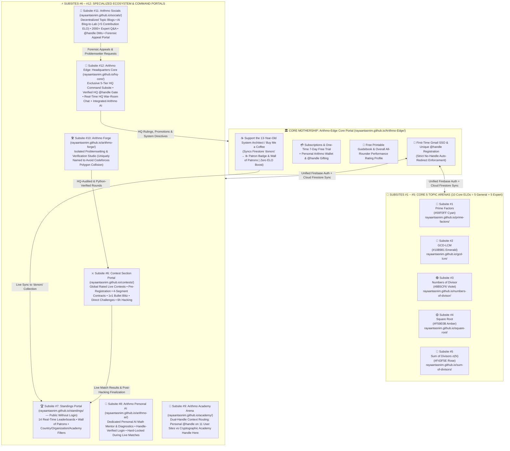
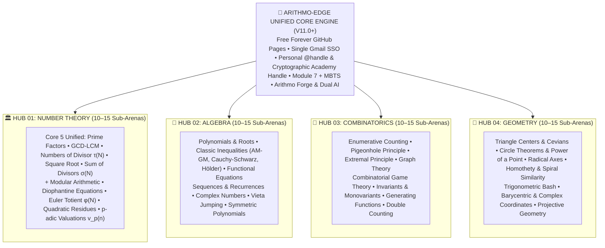

<div align="center">


# 🌌 Prime-Factor.app $\rightarrow$ **Arithmo-Edge**
### *The World's First Real-Time ELO-Rated Competitive Mathematics & Olympiad Mega-Ecosystem — Powered by Olympiad Edge*

[](https://rayaantasnim.github.io/Arithmo-Edge/)
[](https://rayaantasnim.github.io/Arithmo-Edge/)
[](https://pages.github.com)
[](https://firebase.google.com)
[](https://ai.google.dev)
[](#dropdown-6-arithmo-forge-subsite-10-5-pillar-legal-problem-engine--zero-fp-anti-cheat)

</div>

---

## 🏛️ 1. The 13-Site Unified Architecture (1 Core Portal + 12 Subsites) on Free Forever GitHub Pages

<div align="center">

</div>

<br/>

**Arithmo-Edge** operates as a **13-Website Federated Competitive Mathematics Mega-Ecosystem (`1 Core Portal + 12 Subsites`)** deployed on **100% Free Forever GitHub Pages (`rayaantasnim.github.io/...`) + GitHub Actions** with **zero domain purchase costs**. All 13 portals are unified under **one single Firebase Project** (`Firebase Auth + Cloud Firestore`) and governed by a **Strict No-Handle Auto-Redirect Gate**:

> **🔐 Strict No-Handle Auto-Redirect Protocol:**  
> Every user MUST first authenticate via Google OAuth 2.0 (Gmail SSO) on the **Arithmo-Edge Core Portal (`rayaantasnim.github.io/Arithmo-Edge/`)** to register their globally unique `@handle`. If a user signs into any of Subsites `#1–#12` with a Gmail account that lacks a registered `@handle` in Firestore, the client SDK immediately intercepts the session and auto-redirects them back to the **Core Portal `@handle` Onboarding Gate**.

### 🌐 A. 13-Site Federated Ecosystem Blueprint (`Mermaid.js`)



---

### 🧩 B. Complete 13-Website Directory & Functional Breakdown

| Site ID | Portal Name & Free Forever GitHub Pages URL | Core Responsibilities & Architectural Rules |
| :---: | :--- | :--- |
| **Core** | **Arithmo-Edge Core Portal**<br>`rayaantasnim.github.io/Arithmo-Edge/` | • **First-Time Gmail SSO & `@handle` Registration:** Mandatory entry point before accessing any subsite (enforces Strict No-Handle Auto-Redirect).<br>• **Subscriptions & One-Time 7-Day Free Trial:** Manages Free, Plus, Pro, Singularity, and Academy institutional subscriptions.<br>• **Personal Arithmo Wallet:** Stores top-up credits, micro-passes, `@handle` pass gifts, and `Contribution ELO` milestone bonuses.<br>• **Free Printable Guidebook & Overall Rating:** Hosts the free printable master handbook and displays the user's unified **Overall All-Rounder Performance Rating** profile.<br>• **☕ Support the 13-Year-Old System Architect / Buy Me a Coffee:** Dedicated donation portal syncing donors in real time to the Firestore `donors` collection, unlocking a `☕ Patron` profile badge and placement on the public **Wall of Patrons** on Standings—with **strictly zero ELO boost**. |
| **#1** | **Prime Factors Arena**<br>`rayaantasnim.github.io/prime-factors/` | • **Signature Theme:** Fixed **Electric Cyan (`#00F0FF`)** dark neon cyber-theme *(strictly no light/dark theme toggle on any arena)*.<br>• **Features:** Unrated Practice, **Virtual Gym**, topic **Problemset**, and Dual Core ELOs (`General ELO` + `Expert ELO`). |
| **#2** | **GCD-LCM Arena**<br>`rayaantasnim.github.io/gcd-lcm/` | • **Signature Theme:** Fixed **Mint Emerald (`#10B981`)** dark neon cyber-theme.<br>• **Features:** Unrated Practice, **Virtual Gym**, topic **Problemset**, and Dual Core ELOs (`General ELO` + `Expert ELO`). |
| **#3** | **Numbers of Divisor Arena**<br>`rayaantasnim.github.io/numbers-of-divisor/` | • **Signature Theme:** Fixed **Vibrant Violet (`#8B5CF6`)** dark neon cyber-theme.<br>• **Features:** Unrated Practice, **Virtual Gym**, topic **Problemset**, and Dual Core ELOs (`General ELO` + `Expert ELO`). |
| **#4** | **Square Root Arena**<br>`rayaantasnim.github.io/square-root/` | • **Signature Theme:** Fixed **Laser Amber (`#F59E0B`)** dark neon cyber-theme.<br>• **Features:** Unrated Practice, **Virtual Gym**, topic **Problemset**, and Dual Core ELOs (`General ELO` + `Expert ELO`). |
| **#5** | **Sum of Divisors $\sigma(N)$ Arena**<br>`rayaantasnim.github.io/sum-of-divisors/` | • **Signature Theme:** Fixed **Nebula Rose (`#F43F5E`)** dark neon cyber-theme.<br>• **Features:** Unrated Practice, **Virtual Gym**, topic **Problemset**, and Dual Core ELOs (`General ELO` + `Expert ELO`). *(Total across Subsites #1–#5 = **10 Core ELOs**).* |
| **#6** | **Contest Section Portal**<br>`rayaantasnim.github.io/contests/` | • Houses all global rated live contests, pre-registrations, 4-segment contract cards, **1v1 Bullet Blitz (ELO-rated)**, **Direct Friend Challenges**, and **6-Hour Hacking**. |
| **#7** | **Standings Portal**<br>`rayaantasnim.github.io/standings/` | • **Publicly viewable without login** (like Codeforces), housing **14 Real-Time Leaderboards**, Country/Organization/Academy filters, and the **Wall of Patrons**. |
| **#8** | **Arithmo Personal AI**<br>`rayaantasnim.github.io/arithmo-ai/` | • Dedicated personal AI Math Mentor & Diagnostics subsite; requires handle-verified Gmail login and is **hard-locked during live rated matches**. |
| **#9** | **Arithmo Academy Arena**<br>`rayaantasnim.github.io/academy/` | • Isolated institutional subsite for schools, colleges, coaching centers, and universities using **Dual-Handle Context Routing**: the same Gmail loads the user's personal `@handle` across the other 11 user sites, while automatically loading the institution's **Cryptographic Academy Handle** inside Academy Arena. |
| **#10** | **Arithmo Forge**<br>`rayaantasnim.github.io/arithmo-forge/` | • Isolated problemsetting & verification studio—uniquely named **Arithmo Forge** to avoid Codeforces Polygon collision; used by both qualified community problemsetters and HQ problem architects. |
| **#11** | **Arithmo Socials**<br>`rayaantasnim.github.io/socials/` | • Decentralized topic blogs, AI-curated **Blog-to-Lab** pipeline (`+5 Contribution ELO`), Expert Q&A (`2000+ ELO`), `@handle` DMs, **Forensic Appeal Portal**, and global **`Contribution ELO`** profile display. |
| **#12** | **Arithmo Edge: Headquarters Core**<br>`rayaantasnim.github.io/hq-core/` | • Exclusive command subsite accessible **only via verified HQ member `@handle` login** for the 5-tier HQ panel.<br>• Features a **real-time HQ war-room chatbox & discussion system with integrated Arithmo AI** to plan next steps, position-based access control, **HQ ELO** showcase, **Forensic Appeal Management**, and **Problemsetter / Contribution Request Management**. |

---

### 🌍 C. `V11.0+` Four Core IMO Hubs Mega-Expansion (`Mermaid.js`)

In `V11.0+`, the foundational 5 Number Theory arenas unify into **Hub 01: Number Theory** alongside **Hub 02: Algebra**, **Hub 03: Combinatorics**, and **Hub 04: Geometry**—expanding to **10–15 specialized sub-arenas per hub** (`40–60` total arenas) all powered by Free Forever GitHub Pages and Unified Firebase:



---

## 📚 2. Expandable Architectural Deep-Dives

<details id="dropdown-1-weekly-7-day-contest-calendar-no-rest-day-round-indexing--arena-ui-modes">
<summary><strong>📅 Dropdown 1: Weekly 7-Day Contest Calendar (NO REST DAY!), Round Indexing & Arena UI Modes</strong></summary>

<br/>

<div align="center">

</div>

<br/>

#### 🗓️ A. 7-Day Rotational Schedule (Strictly NO Rest Day!)
Every single day of the week features an official global rated competition on **Subsite #6 (`Contest Section Portal`)**:

```text
┌───────────┬────────────────────────────────────────────┬───────────────────────────────────────────────────────────────┐
│    DAY    │           ROUND INDEXING & ARENA           │                    TIMING & CONTEST FORMAT                    │
├───────────┼────────────────────────────────────────────┼───────────────────────────────────────────────────────────────┤
│ Monday    │ 🔹 Prime Factor Round #1, #2...            │ 17:00 UTC Expert Mode (0+ ELO)  |  20:00 UTC General Mode     │
│ Tuesday   │ 🔸 GCD-LCM Round #1, #2...                 │ 17:00 UTC Expert Mode (0+ ELO)  |  20:00 UTC General Mode     │
│ Wednesday │ 🟣 Numbers of Divisor Round #1, #2...      │ 17:00 UTC Expert Mode (0+ ELO)  |  20:00 UTC General Mode     │
│ Thursday  │ 🟡 Square Root Round #1, #2...             │ 17:00 UTC Expert Mode (0+ ELO)  |  20:00 UTC General Mode     │
│ Friday    │ 🌹 Sum of Divisors σ(N) Round #1, #2...    │ 17:00 UTC Expert Mode (0+ ELO)  |  20:00 UTC General Mode     │
│ Saturday  │ 🏆 Special Theme Episodes                  │ IMO Simulation Episode #1 • Number Theory Contest #1 •        │
│           │    (Rotating Weekly Series)                │ Arithmo Special #1 • Olympiad Challenge #1 • Math Query #1    │
│ Sunday    │ 🔥 SUNDAY MEGA ARENA CONTEST               │ Prepared exclusively by Core HQ Team • Single Arena Focus     │
│           │    (NO REST DAY — High-Stakes Flagship)    │ Default Expert Mode • 100 Min • 10 Qs • Max 2 Subs/Question   │
└───────────┴────────────────────────────────────────────┴───────────────────────────────────────────────────────────────┘
```

#### 🔥 B. Sunday Mega Arena Contest Protocol (NO Rest Day)
* **Exclusive Core HQ Preparation:** Authored and audited solely by the **Core HQ Team**, focused on a single spotlight arena.
* **Default Expert Mode Only:** No General/Expert mode choice—every competitor enters the unified **Default Expert Mode** interface.
* **Open Eligibility:** Open to all rated users worldwide alongside an optional **Unrated** registration toggle.
* **Format & Finalization Timeline:**
  * **Duration & Volume:** `100 minutes`, `10 questions`, strict **Max 2 submissions per question**.
  * **Post-Contest Pipeline:** `2-hour` Hacking Session + `1-hour` MBTS Telemetry Clustering = **Final official results at `T+3 hours`**.

#### 🎟️ C. Multi-Stage Contest Registration Flow (`Subsite #6`)
```text
[1. Upcoming Events List]
        │
        ▼
[2. Dedicated Event Page] ──► Choose Mode: [ General ]  OR  [ Expert ]
        │
        ▼
[3. Expands 4 Segment Cards] (Initiate/Contender/Advanced/Finalist OR Apprentice/Intermediate/Vanguard/Apex)
        │
        ▼
[4. Dedicated Segment Contract Page] ──► Displays exact rules, timers, and Module 7 + MBTS Legal Contract
        │
        ▼
[5. Final Registration Choice] ──► [ Register as Rated ]   vs   [ Register as Unrated ]
```
* **Forced Unrated Registration:** If a user's running ELO exceeds the selected segment's maximum ELO cap, the **`Register as Rated`** button is disabled—enforcing **Forced Unrated Registration**.
* **Cross-Mode Dual Registration Rule:** Users **CAN** register for **BOTH** `General` and `Expert` in the same event (different UTC times), but **CANNOT** register for more than one segment in the same mode.

#### 🖥️ D. General Arena UI vs. Expert Arena UI

| Architectural Dimension | ⚡ General Mode UI (`exam.html` Velocity Flow) | 🏛️ Expert Mode UI (3-Column Toph.co-Style Dashboard) |
| :--- | :--- | :--- |
| **Layout Architecture** | Single-question sequential focus flow (`exam.html` style) minimizing visual distraction. | **3-Column Toph.co-Style Olympiad Dashboard:**<br>• **Left Sidebar:** `Dashboard`, problem list (`A, B, C...`), `Announcements`.<br>• **Center Workspace:** Problem titles, statements, live solve ratios (`12/72`), submission workspace.<br>• **Right Feed:** Live **HQ `Announcements`** feed. |
| **Navigation & Redemption** | **Zero back-review** without submitting or skipping; skipped/missed items loop back in a **Second-Chance Overtime Loop**. | Competitors can **freely navigate across `A..Z`** anytime during the contest. |
| **Submission & Input UX** | • **Zen Focus Mode** toggle.<br>• **Mobile-Only Touch Numpad** (`0–9`, `*`, `^`, `⌫`, `SUBMIT`) eliminating mobile keyboard bounce. | • Strict **Max 2 Submissions per question**.<br>• Live solve-ratio telemetry (`12/72`) updated in real time. |

#### ⚔️ E. Post-Contest 6-Hour Hacking (Regular Expert Rounds)
Following regular daily Expert Rounds, a **6-Hour Dual Hacking Window** opens before `1 hour` of MBTS finalization (`Finalization at T+7h`):
1. **Problem / Edge-Case Hacking (`+25 to +100 pts` + Global Rejudge):** Exposing a mathematical edge case or judge flaw triggers an immediate **Global Rejudge** across all submissions and awards `+25 to +100` scoreboard points.
2. **Opponent Submission Hacking (`+5 to +50 pts` / `-10 pts` Penalty):** Exposing a counterexample against another competitor's accepted submission awards **`+5 to +50 pts`** on success, or deducts **`-10 pts`** on a failed hack attempt.

</details>

---

<details id="dropdown-2-exact-12-tier-elo-matrix-1v1-rated-mechanics-system-expectation-override--virtual-gym">
<summary><strong>📈 Dropdown 2: Exact 12-Tier ELO Matrix, 1v1 Rated Mechanics, System Expectation Override & Virtual Gym</strong></summary>

<br/>

#### 🚫 A. Strict No-Mixed ELO Policy & Profile ELO Distribution
**Arithmo-Edge** enforces a **Strict No-Mixed ELO Policy**: each of the 5 core arenas maintains isolated `General` and `Expert` ratings (`10 Core ELOs` total):
* **Core Portal Profile:** Displays the unified **Overall All-Rounder Rating**.
* **5 Topic Arena Subsites (`#1–#5`):** Each displays its own dual **`General ELO` + `Expert ELO`**.
* **Arithmo Socials (`Subsite #11`):** Displays the single global **`Contribution ELO`**.
* **Arithmo Academy Arena (`Subsite #9`):** Displays the single institutional **`Academy ELO`**.

#### 🏅 B. Complete 12-Tier Arena Rank Matrix

| Tier | ELO Bracket | 🔹 Prime Factors | 🔸 GCD-LCM | 🟣 Numbers of Divisor | 🟡 Square Root | 🌹 Sum of Divisors $\sigma(N)$ |
| :---: | :---: | :--- | :--- | :--- | :--- | :--- |
| **Tier 1** | `0–499` | *Foundry Initiate* | *Base Radical* | *Divisor Novice* | *Radical Apprentice* | *Factor Adder* |
| **Tier 2** | `500–899` | *Composite Apprentice* | *Euclidean Initiate* | *Factor Seeker* | *Square Finder* | *Aliquot Initiate* |
| **Tier 3** | `900–1199` | *Sieve Calibrator* | *Quotient Scout* | *Prime Power Scout* | *Surd Scout* | *Divisor Series Scout* |
| **Tier 4** | `1200–1399` | *Radix Scholar* | *Divisor Vanguard* | *Divisor Count Tactician* | *Rationalizer Tactician* | *Perfect Number Vanguard* |
| **Tier 5** | `1400–1599` | *Modular Operator* | *Coprime Operator* | *Odd-Even Operator* | *Pellian Root Operator* | *Amicable Operator* |
| **Tier 6** | `1600–1799` | *Prime Strategist* | *Linear Combinator* | *Divisor Summation Voyager* | *Continued Fraction Weaver* | *Multiplicative Weaver* |
| **Tier 7** | `1800–1999` | *Logarithmic Vector* | *Algorithm Tactician* | *Highly Composite Vanguard* | *Quadratic Irrational Vanguard* | *Abundance Tactician* |
| **Tier 8** | `2000–2199` | *Eulerian Sentinel* | *Diophantine Vector* | *Radical Strategist* | *Square-Free Strategist* | *Sigma-K Vector* |
| **Tier 9** | `2200–2399` | *Gaussian Cryptographer* | *Congruence Overlord* | *Divisor Density Overlord* | *Pell-Fermat Overlord* | *Euler Pentagonal Overlord* |
| **Tier 10** | `2400–2699` | *Canonical Analyst* | *Remainder Archon* | *Dirichlet Archon* | *Transcendental Archon* | *Gronwall-Robin Archon* |
| **Tier 11** | `2700–2999` | *Riemann Transcendentalist* | *Infinite Product* | *Voronoi Transcendent* | *Equidistribution Transcendent* | *Eisenstein Transcendent* |
| **Tier 12** | `3000+` | *Prime Singularity* | *Euclidean Singularity* | *Divisor Singularity* | *Radical Singularity* | *Sigma Singularity* |

#### ⚡ C. 1v1 Bullet Blitz ELO Mechanics (`Subsite #6`) & System Expectation Override
$$\Delta R = K \times \left(\text{Actual Performance} - \text{Expected Curve}(R_{\text{self}}, R_{\text{opp}})\right)$$
* **Topic-Specific Rating Isolation:** Rated 1v1 matches in both **Random Global Pool (`±100 ELO`)** and **Direct Friend Challenges** update **only** the specific topic arena's ELO.
* **Opponent Strength Scaling:** Defeating higher-rated opponents yields substantially larger `+\Delta R` gains.
* **System Expectation Override (`+ΔR` Underdog Protection):** Rewards underdogs with **positive ELO (`+ΔR`)** even in narrow losses if their millisecond solve speed and accuracy outperform the system's expected performance curve.

#### 🏋️ D. Virtual Participation (`Virtual Gym`)
* **Real-Time Ghost Leaderboard Simulation:** Replays historical live contests timestamp-by-timestamp, inserting the participant onto the scoreboard with a **`#` / `Virtual`** badge.
* **Strict Unrated Policy + Simulated ELO Delta:** Virtual runs never alter official ELO, but compute and display an accurate **Simulated ELO Delta** (`+45` / `-20`) upon completion.
* **Proctoring & Practice Hack:** Includes optional **Module 7** proctoring and an offline **Practice Hack** mode.
* **Access Tiers:** **Solo Mode** is **100% Free**; **Private Group Rooms** are unlocked for `Pro` (max `10` members) and `Singularity` (**unlimited** members).

</details>

---

<details id="dropdown-3-standings-portal-subsite-7-14-real-time-leaderboards--monotonic-hq-elo">
<summary><strong>🏆 Dropdown 3: Standings Portal (<code>Subsite #7</code>), 14 Real-Time Leaderboards & Monotonic HQ ELO</strong></summary>

<br/>

#### 🌍 A. Public Guest Access & Drill-Down Architecture
* **Public Without Login:** Viewable without login (Country, Organization, Academy filters & Wall of Patrons require zero authentication; logging in unlocks **Pinned Personal Standing** and the **`★ My Friends`** filter).
* **Navigation Drill-Down (`5 Category Buttons` $\rightarrow$ `14 Live Boards`):**
  `Homepage` $\rightarrow$ `Explore Real Time Leaderboard` $\rightarrow$ **5 Category Buttons** unlocking **14 Live Boards**:
  1. **Headquarters (`1 Board`):** Displays **ALL HQ members** (not capped at Top 100). Enforces **Strict Positional Chronology** (a lower rank never passes a higher rank even if raw HQ ELO exceeds).
  2. **5 Core Arenas (`10 Boards`):** Select Arena $\rightarrow$ Select `General` or `Expert` (`5 × 2 = 10` boards).
  3. **Academy (`1 Board`):** Global ranking of institutions by unified single **`Academy ELO`**.
  4. **Contributors (`1 Unified Board — No Arena Division`):** Single global leaderboard for **`Contribution ELO`**.
  5. **All Rounders (`1 Board`):** Combined multi-arena composite performance index.

#### 👑 B. Monotonic HQ ELO & 5-Tier Command Ladder (`Subsite #12: Headquarters Core`)
* **Monotonic Non-Decreasing Rule:** HQ ELO **never decreases**—it grows slowly via junior Q&A help, contributions, problemsetting, and system deeds.
* **5-Tier Starting HQ ELOs & Command Ladder:**

```text
[100 HQ ELO] Core Sentinel ──► [300 HQ ELO] Problem Architect ──► [500 HQ ELO] Round Coordinator ──► [750 HQ ELO] Chief Arbiter ──► [1000 HQ ELO] Prime Sovereign (Top 3 • Flag-Immune)
```
* **Dual Promotion Requirement:** Promotion requires **BOTH** the target HQ ELO bracket **AND** an exact **Prime Sovereign Certificate**.
* **HQ Induction Protocol:** Induction requires **`+200 Contribution ELO` + `6` latest clean rated matches + Prime Sovereign Certificate** $\rightarrow$ triggers an auto-notification requiring **affirmative user consent** *(plus rare Prime Sovereign direct induction)*.

</details>

---

<details id="dropdown-4-refined-subscriptions-dual-ai-systems-arithmo-personal-ai--arithmo-guild-ai--rich-pay-as-you-go-store">
<summary><strong>💳 Dropdown 4: Refined Subscriptions, Dual AI Systems (Arithmo Personal AI & Arithmo Guild AI) & Rich Pay-As-You-Go Store</strong></summary>

<br/>

#### 🎟️ A. Refined Personal Subscriptions *(7-Day One-Time Free Trial • Strict 1-Month Minimum & No-Refund Policy)*

| Personal Plan | Monthly Price | Core Benefits, 1v1 Quotas, Virtual Gym & Arithmo Personal AI Quotas |
| :--- | :---: | :--- |
| **Free** | **`$0/mo`** | • All rated daily & Sunday Mega contests<br>• **`5` lifetime free** 1v1 global pool challenges<br>• **`5` monthly** `Arithmo Personal AI (General)` queries<br>• Solo Virtual Gym & Free Printable Guidebook |
| **Plus** | **`$2.99/mo`** | • Ad-free arena + **`Plus` badge**<br>• **`5` daily** 1v1 matches<br>• **`40` monthly** `Arithmo Personal AI (General)` queries<br>• **`10` monthly** virtual contests + **`200`-problem vault** |
| **Pro** *(Most Popular)* | **`$5.99/mo`** | • **`20` daily** 1v1 matches + **Direct Friend Challenges** (`@handle` / Link)<br>• **`150` monthly** `Arithmo Personal AI` queries *(including **`30` Premium `2x` tokens**)*<br>• Unlimited Virtual Gym + **Private Rooms (max `10` members)**<br>• Weekly AI diagnostics & **Smart Mistake Deck** |
| **Singularity** | **`$12.99/mo`** | • **Unlimited `Arithmo Personal AI`** *(direct **Premium `2x` Hybrid AI** + Ultra-Low Latency)*<br>• **Unlimited** 1v1 & Direct Friend Challenges + **Unlimited group rooms**<br>• **Arithmo Forge** contest hosting (`1500+ ELO`) + fast-track appeals + **`Singularity` badge** |

#### 🧠 B. Dual AI Systems & Dynamic Semantic Token Metering
1. **Arithmo Personal AI (`Subsite #8`):** Context-injected personal mentor (reads all **15 ELOs** & match telemetry; **hard-locked during live matches**).
2. **Arithmo Guild AI (Navbar Tab inside `Subsite #9: Academy Arena`):** Pre-fed with academy standings/performance & linked to **Arithmo Personal AI**. Purchased **only by Academy Admins** via the **Academy Wallet**.
3. **Dynamic Semantic Metering (Applies to Both AIs):**
   * Duplicate question asked twice = **`-1` quota total**.
   * $N$ distinct questions packed in one message = **`-N` quotas**.
   * Greetings / short follow-up clarifications = **`0` quota cut**.
4. **In-Chat Dual-Model Selector Pop-up & Dynamic Default:**
   * Whenever a user or academy holds credits for **BOTH** `General (1x)` and `Premium (2x)` models simultaneously, opening the AI chatbox displays a **Model Selection Pop-up**—while automatically setting the **dynamic default** based on query complexity *(simple queries default to `General 1x`; deep Olympiad proofs default to `Premium 2x`)*.

#### 🛒 C. Expanded Pay-As-You-Go Store *(Personal Arithmo Wallet on Core Portal — Supports `@handle` Gifting & `+10%` Bonus Top-Up Bundles)*

| Store Item / Bundle | Price | Exact Quota, Duration & Capabilities |
| :--- | :---: | :--- |
| **AI General Starter Pack** | **`$0.99`** | **`20` no-deadline tokens** (`General 1x`). |
| **AI Premium `2x` Deep Pack** | **`$2.99`** | **`30` no-deadline tokens** (`Premium 2x` — Deep Analysis, Hybrid Models & High Queue Priority). |
| **24-Hour AI Grandmaster Sprint** | **`$3.99`** | **`24h` unlimited access** to **both** `General 1x` and `Premium 2x`. |
| **Duelist 5-Pack** | **`$0.99`** | **`5` no-deadline** 1v1 & Direct Friend Challenge tokens (`30-min` expiration with **Global Pool Fallback**). |
| **24-Hour Unlimited Arena & Room Pass** | **`$1.99`** | **`24h` unlimited** 1v1 duels + custom private Virtual Gym rooms (**max `10` members**). |
| **Forge Contest Host Token** | **`$2.49`** | Host **`1` custom contest** on **Arithmo Forge (`Subsite #10`)** (`1500+ ELO` required). |
| **Deep Contest Post-Mortem & Mistake Deck** | **`$0.99`** | Unlock full solve-time heatmap & **`50`-card spaced-repetition deck** for `1` completed contest. |
| **Arithmo Wallet Top-Up Bundles** | **`$5` / `$10` / `$25` / `$50`** | Instant **`+10%` free bonus credit** + automatic free milestone rewards at **`+50` / `+100` / `+250` / `+500` `Contribution ELO`**. |

</details>

---

<details id="dropdown-5-complete-4-tier-arithmo-academy-arena-subsite-9-architecture">
<summary><strong>🏫 Dropdown 5: Complete 4-Tier Arithmo Academy Arena (<code>Subsite #9</code>) Architecture</strong></summary>

<br/>

#### 👥 A. 3-Role Institutional Hierarchy & Profile Badge Separation
* **3 Institutional Roles:** Every academy consists of **Admin** (`Min 1 – Max 5`; `Max 10` in Enterprise), **Mentor** (`Min 1 – Max 15` — posts homework in the dedicated **`Task`** navbar tab where Members submit solutions), and **Members**.
* **Profile Badge Separation:** Academy **Members** and **Mentors** display their equivalent personal tier badge (`Plus`, `Premium`, or `Singularity`) on their public profiles, while **ONLY Academy Admins** display the official **Academy package badge**.

#### 🏛️ B. 4 Institutional Sub-Packages *(Strict 1-Month Minimum • No-Refund Policy • 5-Day Renewal Ultimatum • Admin Monthly Fee Waived)*

| Academy Tier | Base Monthly Price | Roster Cap, Member Fee & Badge | Admins & Mentors | Arithmo Guild AI & Exclusive Institutional Features |
| :--- | :---: | :--- | :---: | :--- |
| **Academy General** | **`$29.99/mo`** | Max **`100` members**<br>(`$0.99/mo` member fee • `Plus` badge) | `1–5` Admins<br>`1–15` Mentors | **`20` Arithmo Guild AI msgs/mo**, lab IP whitelisting, attendance reports, `Task` homework tab. |
| **Academy Premium** | **`$49.99/mo`** | Max **`500` members**<br>(`$2.99/mo` member fee • `Premium` badge) | `1–5` Admins<br>`1–15` Mentors | **`80` Arithmo Guild AI msgs/mo**, **AI Batch Weak-Topic Radar**, eligible for **Inter-Academy Clash Championships** (`$4.99` one-time entry). |
| **Academy Supreme** | **`$79.99/mo`** | Max **`1,000` members**<br>(`$6.99/mo` member fee • `Singularity` badge) | `1–5` Admins<br>`1–15` Mentors | **`200` Arithmo Guild AI msgs/mo**, **ALL Pay-As-You-Go features included 100% FREE** *(free Inter-Academy Clash, free Academy Guidebook, free on-demand contests, free Virtual Edu Lab, QR certificates)*. |
| **Academy Enterprise** | **`$149.99` First Month**<br>(`$79.99/mo` Base Renewal) | **Unlimited members**<br>(All get `Singularity` tier • Dynamic member fee: `$5.99/mo` when `< 1,000` members; `$7.99/mo` for extras `> 1,000` members) | **`1–10` Admins**<br>`1–15` Mentors | **Dynamic Arithmo Guild AI scaling:** `200` premium tokens up to `1,000` members + **`+15` premium tokens per `50` extra members**.<br>*(Outsider appeal fee `$19.99` vs `$9.99` in lower tiers; all Supreme perks included).* |

#### 💼 C. Institutional Pay-As-You-Go (`Academy Wallet — Admin-Only`)
* **`$1.99`:** HQ Group Contest *(Free for Supreme & Enterprise)*.
* **`$4.99`:** HQ Private Room Single Contest *(Free for Supreme & Enterprise)*.
* **`$9.99`:** Mentor Custom Problemset Contest *(Free for Supreme & Enterprise)*.
* **`$4.99`:** Inter-Academy Clash Championship Entry *(Free for Supreme & Enterprise)*.
* **`$2.99` / `24h`:** **Virtual Edu Lab** — real-time AI fact-checks critical false math theories directly in chat *(Free for Supreme & Enterprise)*.
* **`$14.99/mo`:** **1-Month Academy Guidebook** (`3-day` grace period; **free** for Supreme & Enterprise).
* **Arithmo Guild AI Top-Ups:**
  * `General 1x`: **`15` tokens for `$3.99`** | **`48h` unlimited for `$7.99`**.
  * `Premium 2x`: **`15` tokens for `$7.99`** | **`48h` unlimited for `$14.99`**.

#### 📖 D. Dual Guidebooks, `+2 Contribution ELO`, Onboarding & Dual Standings
* **Dual Guidebooks & `+2 Contribution ELO`:** Both the **Academy Guidebook** and **Free Printable Guidebook** award **`+2 Contribution ELO`** personally to any contributor whose math is certified by **Gemini** and approved by **HQ** *(academies hold no contribution points)*.
* **Onboarding & Governance:** Pioneer gets a **Cryptographic Academy Handle & Token**, sets a passcode + Invite URL or appends `@handle`. Member Admin promotion requires **Admin Head approval + `$2.99` fee**; Admins can step down after naming a successor (`min 1 member` rule).
* **Dual Standing Tabs:** **`Academy Standing`** (inter-academy `Academy ELO`) and **`Members Standing`** (shows each member's rank **both inside their Academy AND across the entire global userbase**).

</details>

---

<details id="dropdown-6-arithmo-forge-subsite-10-5-pillar-legal-problem-engine--zero-fp-anti-cheat">
<summary><strong>🛠️ Dropdown 6: Arithmo Forge (<code>Subsite #10</code>), 5-Pillar Legal Problem Engine & Zero-FP Anti-Cheat</strong></summary>

<br/>

#### 🧬 A. 5-Pillar Legal & Creative Problem Engine (`Arithmo Forge`)
1. **Procedural Olympiad Python Generators:** Deterministic, parameterized generators producing fresh problem instances.
2. **Arithmo Forge Community Problemsetters:** Open to verified authors with **`1500+ ELO` + `6` clean rated matches**.
3. **Public Domain Math Re-Engineering:** Classic public-domain Olympiad problems structurally re-engineered with new bounds and constraints.
4. **Weekly HQ Master's Vault:** Hand-crafted problems curated by HQ for **Sunday Mega Arena Contests** and **Saturday Special Episodes**.
5. **Golden Reference Bank + AI Creative Synthesis:** Feeds top Olympiad benchmarks into **Arithmo AI + Gemini** to synthesize brand-new, more complex and creative original problems—**strictly never copying**.

#### ⚙️ B. Smart Compute Routing
* **Smaller / Easier Segments:** Generate directly via AI reasoning pipelines without heavy Python codebase execution.
* **Complex / Apex Segments:** Require Gemini to write and execute a **100% Python verification sandbox** before publishing.

#### 🛡️ C. Zero-False-Positive Anti-Cheat (`Module 7` + `MBTS`), Alt Defense & Forensic Appeals
* **Camera / Mic Permission Gate:** Mandatory `getUserMedia` camera and microphone permission before entering any rated contest.
* **`4.5s` Adaptive Gaze Guard:** Grace buffer widens to **`4.5 seconds`** during multi-factor calculation pauses so honest mental math calculation never triggers false positives.
* **3-Axis Neural Audio Trap:** Fires only when **(1)** external voice phoneme matches a number/factor, **(2)** gaze drops off-screen, **AND** **(3)** exact answer is typed in `100ms–2500ms` with zero backspaces.
* **11-Flag Blackhole Lockdown Ladder:**
  * `Flags 1–2`: Next **1** positive-ELO match nullified to `0`.
  * `Flags 3–8`: Next **2** positive-ELO matches nullified to `0`.
  * `Flag 9`: Next **3** positive-ELO matches nullified to `0`.
  * `Flag 10`: **1-Month Temporary Ban** + hardware reset.
  * `Flag 11`: **Permanent Gmail & IP Ban** across all 13 sites.
* **4-Signal Alt / Self-Upvote Silent Neutralization:** Correlates IP/subnet, device fingerprint, keystroke cadence, and reciprocal vote graphs to **silently neutralize** sockpuppet `Contribution ELO`.
* **4-Step Forensic Appeal Verification:** Encrypted telemetry packet + **AI Honesty Score** + **5-min Live Skill Audit** + **Chief Arbiter** review *(banned users retain **`7-day` post-ban appeal access** strictly to `Subsite #11: Arithmo Socials`' Forensic Appeal Portal, managed by HQ inside `Subsite #12: Headquarters Core`)*.

</details>

---

<details id="dropdown-7-master-version-roadmap-v32-through-v110">
<summary><strong>🗺️ Dropdown 7: Master Version Roadmap (<code>V3.2</code> through <code>V11.0+</code>)</strong></summary>

<br/>

| Release Milestone | Architectural & Feature Deliverables |
| :--- | :--- |
| **`V3.2 – V3.3` *(Live)*** | Client-side Brent-Pollard's Rho & Miller-Rabin JS engine, `Space = *` / `Enter = Submit` zero-mouse hotkeys, Unified Firebase Auth + Cloud Firestore genesis, Season 2 baseline ratings on Free Forever GitHub Pages. |
| **`V3.4`** | Global Standings (`Subsite #7`), unique `@handle` registration with Strict No-Handle Auto-Redirect, `★ Star Friends` filter, and public profiles. |
| **`V4.0 – V5.4`** | Daily `20:00 UTC` **General Arena** (`exam.html` flow + Mobile Touch Numpad + Overtime Loop) & `17:00 UTC` **Expert Arena** (**3-Column Toph.co-Style Dashboard** + Max 2 submissions + `6h` Hacking + Global Rejudge), **Module 7** (`4.5s` Adaptive Gaze Guard + 3-Axis Audio Trap) + **MBTS** clustering. |
| **`V6.0 – V7.5`** | **Arithmo Forge (`Subsite #10`)**, **Dual Wallets** (Personal Arithmo Wallet + Institutional Academy Wallet), **1v1 Bullet Blitz** & Direct Friend Challenges (`30-min` Global Pool Fallback), **Arithmo Socials (`Subsite #11`)** topic blogs, AI Blog-to-Lab pipeline (`+5 Contribution ELO`), `2000+ ELO` Expert Q&A, and Dual Guidebooks (`+2 Contribution ELO`). |
| **`V8.0 – V9.3`** | **Arithmo Personal AI (`Subsite #8`) & Arithmo Guild AI (`Subsite #9`)** with Dynamic Semantic Token Metering + In-Chat Dual-Model Selector (`General 1x` / `Premium 2x`), **5-Tier Monotonic Headquarters (`Subsite #12: Headquarters Core`)** with real-time HQ war-room chat & integrated Arithmo AI, and **Saturday Special Episodes** (*IMO Simulation, Number Theory Contest, Arithmo Special, Olympiad Challenge, Math Query*). |
| **`V10.0 – V10.3`** | • **`V10.0`:** Context-Injected **Arithmo Personal AI** reading all 15 ELOs & telemetry logs.<br>• **`V10.1`:** **Annual World Cup** (`Top 128`) using a 6-round **Progressive Half-Elimination** bracket (`128 → 64 → 32 → 16 → 8 → 4 → Champion`) awarding permanent rotating **Golden Crowns (`👑`)**.<br>• **`V10.2`:** Offline-first installable **PWA** with `T-15 min` contest push notifications.<br>• **`V10.3`:** **AI Smart Mistake Deck** generating 7-day spaced-repetition flashcards from contest misses. |
| **`Post-10.3 / V11.0+`** | Full **13-Site Federated Ecosystem (`1 Core + 12 Subsites`)** on Free Forever GitHub Pages & **4 Core IMO Hubs** (*Number Theory, Algebra, Combinatorics, Geometry* — `10–15` sub-arenas per hub). |

</details>

---

## ⚙️ 3. Categorized Modern Tech Stack & Free GitHub Pages Deployment

<div align="center">

</div>

<br/>

### 🛠️ Categorized Production Tech Stack

* **Frontend Architecture & Cyber-Olympiad UI:**
  * **Tailwind CSS** & **Cyber-Olympiad Glassmorphism UI** (fixed dark neon cyber-themes across all arenas).
  * **Vite / React / Vanilla ES6+** modular client builds optimized for sub-50ms static delivery.
  * **KaTeX & MathJax** for crisp real-time $\LaTeX$ Olympiad problem rendering.
  * **Three.js (WebGL)**, **GSAP (GreenSock)**, and **Framer Motion** for 60fps interactive visualizations and smooth state transitions.
* **Client-Side Mathematics, Telemetry & Anti-Cheat (`Module 7`):**
  * **Brent-Pollard's Rho & Miller-Rabin JS Engine** for instant client-side prime factorization and primality verification.
  * **Web Audio API** for tactile zero-latency sound feedback and acoustic trap telemetry.
  * **MediaPipe / TensorFlow.js (`Module 7`)** powering the `4.5s` Adaptive Gaze Guard and 3-Axis Neural Audio Trap directly on-device.
* **AI Orchestration & Verification Pipelines:**
  * **Google Gemini SDK (`Pro` & `Flash`) + Python / SymPy Sandbox** for 100% mathematical verification of Apex segments and Golden Reference synthesis.
  * **Semantic Intent & Token Router** powering Dynamic Semantic Token Metering and the In-Chat Dual-Model Selector (`General 1x` vs `Premium 2x`).
* **Unified Backend, Edge Proxy & Free Forever Hosting:**
  * **Unified Firebase Auth & Cloud Firestore** synchronizing all **13 sites** (`1 Core + 12 Subsites`), dual handles, 15 ELO ledgers, `donors` collection, and HQ war-room chat.
  * **Free Forever GitHub Pages (`rayaantasnim.github.io/...`) + GitHub Actions CI/CD & Cron** for zero-cost static hosting across all 13 repositories plus scheduled `MBTS` telemetry clustering and Python verification workflows.
  * **Cloudflare Workers** for serverless edge API proxying and `GEMINI_API_KEY` protection.
  * **Lemon Squeezy / Paddle Webhooks** for automated global subscription, wallet top-up, and `☕ Patron` badge fulfillment.

---

### 🚀 Local Development & Free Forever GitHub Pages Deployment

```bash
# 1. Clone the Arithmo-Edge Core Portal repository
git clone https://github.com/rayaantasnim/Arithmo-Edge.git
cd Arithmo-Edge

# 2. Install dependencies
npm install

# 3. Configure Unified Firebase, AI & Webhook environment variables (.env.local)
cat <<EOF> .env.local
VITE_FIREBASE_API_KEY=your_unified_firebase_api_key
VITE_FIREBASE_AUTH_DOMAIN=arithmo-edge.firebaseapp.com
VITE_FIREBASE_PROJECT_ID=arithmo-edge-prod
VITE_CORE_PORTAL_URL=https://rayaantasnim.github.io/Arithmo-Edge/
VITE_WORKER_PROXY_URL=https://api.arithmo-edge.workers.dev
EOF

# 4. Run local Vite development server
npm run dev

# 5. Build production bundle & deploy to Free Forever GitHub Pages (gh-pages)
npm run build
npx gh-pages -d dist
```

<br><br>
<div align="center">

---

Authorized by Rayaan Tasnim <br>
© All Rights Reserved <br>
© Arithmo-Edge <br>
Powered by Olympiad Edge

</div>